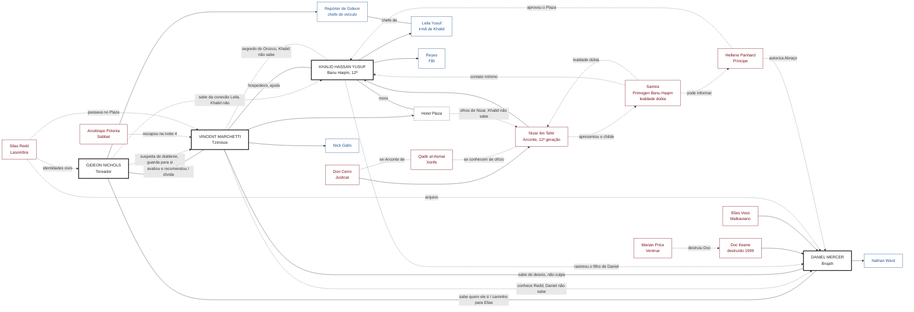

#narrador #relationship-map #auld-sanguine #jogador

# Auld Sanguine: Laços entre Jogadores

> Cruzamento dos backgrounds de [[Gideon Nichols]], [[Vincent Marchetti]], [[Daniel Mercer]] e [[Khalid Hassan Yusuf]]. Primeira rodada com quatro PCs; o Gangrel e os demais jogadores entram depois.
> Método e convenções em [[mapas-de-relacionamento]].

## Sumário
- [[#Como ler este arquivo]]
- [[#Premissas fechadas]]
- [[#Quem sabe o quê]]
- [[#Eixo comum: Nova York, 1999]]
- [[#Laços entre os PCs]]
- [[#O Plaza: Khalid é residente]]
- [[#Nizar, Don Cerro e Samira]]
- [[#Impacto na corte de Nova York]]
- [[#O veículo: onde Leila trabalha]]
- [[#NPCs compartilhados]]
- [[#O que os quatro têm em comum]]
- [[#Mapa (Mermaid)]]
- [[#Perguntas em aberto]]
- [[#Inconsistências a resolver]]
- [[#Fontes]]

---

## Como ler este arquivo

| Marca | Significado |
|---|---|
| ✅ **Decidido** | Escolhido pelo Narrador (Enzo) |
| 📄 **Texto** | Já está escrito nos backgrounds |
| 💡 **Proposto** | Ponte criada a partir dos textos; ainda precisa de aprovação |
| 🔒 **Assimetria** | Um lado sabe e o outro não; não revelar na mesa sem querer |

---

## Premissas fechadas

- ✅ **Os quatro são uma coterie e já se conhecem.** Os laços são cinzentos: ninguém é melhor amigo de ninguém, mas todos têm história com todos.
- ✅ **Tudo está alinhado em 2021.** A nota de Vincent já foi corrigida (era 2022).
- ✅ Para o aliado do Khalid, use só **Reyes** (nunca "Daniel Reyes"). A nota de Khalid já foi corrigida.
- ✅ Vincent é **ex-Sabbat** e isso faz parte da relação com os outros.
- ✅ **Khalid é 12ª geração** (era 13ª na ficha). O sire, **Nizar ibn Tahir**, é **11ª geração**, ancilla e **Arconte do Justicar Don Cerro**.
- ✅ **Ninguém na coterie conhece a identidade do sire de Khalid.** Khalid sabe e a guarda. Gideon suspeita de alguém do alto escalão, sem saber o quanto; só sabe que a Primogen dos Banu Haqim (Samira) é a ponte, e só tem certeza de que **não é ela**.
- Regra de mesa: nada é jogado contra um personagem de outro jogador sem consentimento.

## Quem sabe o quê

Lista de assimetrias, para o Narrador não vazar nada sem querer.

| Segredo / informação | Sabe | Não sabe |
|---|---|---|
| Gideon recomendou Vincent em 1999 | Gideon, Vincent ✅ | |
| **Sensação** de diablerie em Vincent (percebida com os anos, não em 1999) | Gideon 🔒 ✅ (sem certeza) | Vincent, Khalid, Daniel |
| Vincent bebeu do corpo de Orozco | Vincent | Gideon (só suspeita), Khalid, Daniel |
| Vincent conhece **Silas Redd** | Vincent 🔒 ✅ | Daniel (não sabe que Vincent o conhece), Khalid |
| Daniel teve papel no **desvio de tropas** | Vincent ✅, Gideon ✅ | |
| A repórter de Gideon trabalha com **Leila** | Gideon 🔒 ✅ | **Khalid** (não faz ideia) |
| Quem Daniel é na Camarilla | Gideon ✅ | |
| Khalid **pesquisou** os outros três ao longo dos anos | Khalid ✅ | Gideon, Vincent, Daniel |
| Khalid sabe do **filho de Daniel** (rastreou por registros de hospital) | Khalid 🔒 ✅ | Daniel |
| **Quem é o sire de Khalid** (Nizar ibn Tahir, Arconte de Don Cerro) | **Khalid** 🔒 ✅ (guarda a identidade), Nizar | Vincent, Daniel, Gideon (só **suspeita** de alguém do alto escalão, sem saber o quanto) |
| **Samira é a ponte** entre o sire e a corte de NY | Gideon ✅, Khalid | Vincent?, Daniel? |
| **Samira não é a sire de Khalid** | Gideon ✅ (única certeza dele), Khalid | |
| **O Plaza é uma extensão do alcance de Nizar** (olhos dele, via Khalid) | Nizar ✅ | **Khalid** (não sabe), Vincent 💡, coterie, corte de Panhard |
| **Lealdade de Samira é dúbia** | Narrador ✅ | Todos os jogadores; Khalid teve pouco contato com ela |
| Nizar é **Arconte** | Khalid ✅, Qadir 💡 | Gideon (só suspeita de "alto escalão"), Vincent, Daniel |

> 🧩 **Dica Para o Narrador**
> A assimetria que mais pesa é a de Nathan. A proteção que Elias montou em volta dele (sobrenome Ward, fichas queimadas) aguentou todos os inimigos de Daniel e **não aguentou um investigador com acesso a registros**. A segunda é o Plaza: o investigador da coterie é, sem saber, o vigiado.

---

## Eixo comum: Nova York, 1999

Três dos quatro estiveram na mesma guerra por lados diferentes. As "noites" de Daniel e Vincent são só o recorte pessoal de cada um.

| Noite | Vincent 📄 | Daniel 📄 | Gideon |
|---|---|---|---|
| Antes | Entrega livros, nomes, lista de havens e horários de sono; leva a oferta aos Giovanni | Doc monta a Segunda Guarda; Daniel carrega ordens e cargas achando que é reserva da Camarilla | Mapeia refúgios e movimentos do Sabbat pelos bastidores da Broadway 📄 |
| 1 | Incêndios nos havens de dia | Entregas, reconhecimento de rotas | ✅ Ele e Vincent se ajudam: informação de refúgios de um lado, a lista do outro |
| 2 | Orozco é morto num trem em Grand Central | Claire morre; a letra de Doc na folha | ✅ Já avaliou e recomendou Vincent à Camarilla |
| 3 | Cerco ao complexo do Bronx começa | Daniel é capturado em Red Hook e julgado; Elias o defende | |
| 4 | Bronx cai; **Polonia e um templar escapam por uma rota que ele pediu para fechar** | **Doc é destruído em Red Hook por uma força de Marian Price**; Torch foge | |
| Depois | Herói de guerra da Camarilla | Liberado sob supervisão; parte como Nomad | Reconhecimento entre alguns anciões 📄 |

> 🧩 **Dica Para o Narrador**
> A noite 4 é a ponte entre Vincent e Daniel: o "único erro" de Vincent (comandantes mandaram a tropa para outro lugar e deixaram a rota aberta) pode ter sido **a resposta ao golpe de Doc em Red Hook**. Vincent **sabe** que Daniel teve papel no desvio, mas ✅ **não o culpa**.

---

## Laços entre os PCs

Os seis pares possíveis. Cada um tem um lado positivo e um negativo, como pede o Core.

### Gideon ↔ Vincent: a dívida e o silêncio
- ✅ Eles se conheceram e se ajudaram na Batalha de Nova York.
- ✅ **Gideon avaliou Vincent em 1999 e o recomendou** à Camarilla. Isso cria uma **dívida relativa**: Vincent deve a Gideon ter sido aceito, mas sabe que Gideon também se beneficiou do que ele entregou.
- ✅ **Gideon não viu nada de estranho em 1999.** Foi com os **anos** que percebeu algo no Vincent, e hoje tem uma **sensação**, sem certeza, de que isso tem relação com **diablerie**. Ele **guarda para si**. Vincent não sabe que Gideon desconfia. 🔒
- ✅ O **Plaza** é cenário natural das festas de Gideon. Por isso Gideon conhece a Broadway por dentro e o Plaza por dentro, e Vincent conhece os dois lados.
- ✅ Os dois **se encontram regularmente**.
- 📄 Ambos foram Abraçados por utilidade e vigiam à distância um mortal que ama (a jornalista; Nick Gallo).
- 💡 Gideon tem uma carta que nunca usou. Vincent tem uma dívida que nunca cobrou. Os dois sabem disso sem dizer.

### Gideon ↔ Daniel: o corretor e quem procura Elias
- ✅ Gideon **sabe quem Daniel é na Camarilla** (o homem que testemunhou contra o sire e foi salvo por Elias).
- ✅ Daniel **pensa em Gideon como o caminho para achar Elias Voss.**
- 📄 Em 1999, Daniel localizou refúgios do Sabbat e reconheceu uma rota do arquivo vazado; Gideon fazia o mesmo trabalho por outro caminho.
- 📄 O arquivo de Doc/Silas Redd cruzava identidades vampíricas com civis: o disfarce de produtor de Gideon pode ter estado ali. 💡
- 💡 **Positivo:** Gideon é intermediário de favores e provavelmente conhece Elias. É o caminho para a audiência com Panhard sobre o Abraço de Nathan.
- 💡 **Negativo:** Gideon sabe o que Daniel carrega e pode cobrar por isso.

### Gideon ↔ Khalid: a repórter que Khalid não sabe que existe
- ✅ A repórter de Gideon (não é a irmã de Khalid) **é chefe de um veículo investigativo**, e **Leila trabalha lá**.
- ✅ **Gideon sabe disso. Khalid não faz ideia** de que na redação da irmã trabalha alguém querido e importante para Gideon. 🔒
- Detalhes do veículo em [[#O veículo: onde Leila trabalha]].
- 💡 **Positivo:** Gideon tem motivo para proteger Leila (ela trabalha com quem ele ama), e por tabela protege o que Khalid mais valoriza.
- 💡 **Negativo:** Gideon guarda uma informação sensível sobre Khalid. Se Khalid descobrir que Gideon sabia e calou, o laço racha.

### Vincent ↔ Daniel: lados opostos da mesma guerra
- ✅ **Lados opostos:** Vincent deu o plano da Camarilla; Daniel foi usado por um sire que quis lucrar com a mesma guerra.
- ✅ Vincent é ex-Sabbat; Daniel carrega a lembrança de Doc entregando famílias ao Sabbat.
- ✅ **Vincent sabe quem era Silas Redd.** Daniel **não sabe que Vincent o conhece**. 🔒 (Como porteiro do Plaza, viu o Lasombra subir ao quinto andar.)
- ✅ **Vincent sabe que Daniel teve envolvimento no desvio de tropas, mas não o culpa.**
- ✅ Ambos têm **desejo de acabar a guerra** (Vincent, pegar Polonia; Daniel, proteger Nathan do que Doc deixou).
- 💡 **Positivo:** a única pessoa que pode ajudar Daniel a achar a cópia do arquivo é a que não pode dizer de onde conhece Redd.
- 💡 **Negativo:** quanto mais Daniel procurar Redd, mais perto chega do Plaza.

### Vincent ↔ Khalid: o hóspede permanente
- ✅ **Khalid não sabe de nada do que Vincent fez com o corpo de Orozco.** Se descobrir, talvez reaja (Convicção contra tiranos, Compulsion de Judgment). 🔒
- ✅ **Khalid é residente permanente no Plaza.** Vincent foi encarregado pela Camarilla de ajudá-lo. Ver [[#O Plaza: Khalid é residente]].
- 💡 **Positivo:** Khalid conhece segurança por dentro e vive entre as câmeras do hotel; Vincent precisa de olhos.
- 💡 **Negativo:** Khalid mora no mesmo prédio que o segredo de Vincent, e é o PC mais bem equipado para descobrir. E o sire dele pode estar vendo por cima do ombro dele.

### Khalid ↔ Daniel: o que um sabe do outro
- ✅ **Khalid sabe mais sobre Daniel do que Daniel sabe sobre Khalid.**
- ✅ Ao longo dos 11 anos desde o Abraço, Khalid **pesquisou os outros membros da coterie** (Vincent, Gideon, Daniel).
- ✅ **Daniel é o mais fácil** de rastrear, por ter sido Abraçado mais recentemente (1993) e porque **o filho tem registros em hospitais**. Khalid fez um **trace back** que chega a Nathan. 🔒
- 📄 Eles têm poucas ligações diretas além disso: não são próximos.
- 💡 **Positivo:** os contatos de Khalid (Reyes, o detetive do NYPD, o técnico de câmeras) servem para achar Elias e Silas Redd.
- 💡 **Negativo:** o que Khalid sabe de Nathan é uma ferida aberta na proteção de Daniel. A Convicção de Daniel, *"Nunca use a família de alguém como arma"*, é a que mais vai pesar quando ele descobrir.

---

## O Plaza: Khalid é residente

✅ Khalid mora de forma permanente no Plaza, hotel de Vincent, por designação das forças da Camarilla em Nova York. O sire dele é poderoso e importante, mas distante: ele viaja e ensinou o que quis, e confiou o childe ao domínio do Plaza para Vincent ajudá-lo.

**Como Khalid foi parar lá** 💡
1. **2010, Washington D.C.:** Nizar Abraça Khalid. Um Arconte não leva um childe recém-criado para campo. Precisa de um domínio estável.
2. **Intermediação:** Nizar usa **Samira**, Primogen Banu Haqim de Nova York, para apresentar o childe à corte (ver [[#Nizar, Don Cerro e Samira]]).
3. **Escolha do Plaza:** a corte de NY aprova porque Vincent é herói de guerra confiável, o hotel é um domínio estável e discreto, e não pertence a nenhum Primogen.
4. **Khalid chega em 2011 ou 2012** 💡, a "ficar até saber se é útil". Está lá há cerca de dez anos.
5. **Cobertura:** consultor de segurança do hotel (usa a credencial falsa de segurança privada). Dá motivo para circular pelas câmeras.

### O Plaza como "olhos de Nizar" 🔒

✅ **Decidido:** o Plaza é uma **extensão do alcance de Nizar**. Khalid funciona como os olhos dele **sem saber**. A lógica: o Plaza é importante o bastante para valer a atenção de um Arconte (hotel de luxo, herói de guerra, trânsito de Kindred de todas as seitas), mas não importante o bastante para ser vigiado diretamente pela corte de Panhard.

✅ **Mecanismos escolhidos (15/10/2026):** o fornecedor e a ligação.
- ✅ **O fornecedor.** Como consultor de segurança, Khalid escolheu o sistema de câmeras e o fornecedor do hotel **por indicação de Nizar**. O sistema tem uma porta dos fundos que Nizar controla. A ironia é cruel: o ex-Homeland Security é o vigiado.
- ✅ **A ligação.** Nizar liga de vez em quando e pergunta "como está o hotel, quem passou por aí", como um sire distante faria. Khalid responde de boa-fé e sem filtro.
- ~~A equipe (funcionário pago por Nizar)~~: descartada. Pode voltar como escalada se Khalid descobrir o fornecedor.
- 🔒 **O que o jogador de Khalid sabe:** que Nizar indicou o fornecedor e que liga de vez em quando perguntando do hotel. **Não sabe** que isso é vigilância. Está no README dele como fatos soltos.

**Consequências para o jogo** 💡
- Tudo que acontece no Plaza (as festas de Gideon, as visitas, Vincent e seus segredos) pode chegar a Nizar, e dele a Don Cerro.
- Se Khalid descobrir, é a mesma estrutura do que ele sente pelo sire: *dar sem cobrar, cobrar depois.* Ele vai se sentir usado pela segunda vez pela mesma pessoa.
- Vincent pode ser surpreendido: a Camarilla lhe confiou o hóspede como favor, e ele não sabe que também vira posto avançado de um Arconte.

---

## Nizar, Don Cerro e Samira

### Nizar ibn Tahir
- ✅ Banu Haqim, **11ª geração, ancilla**, **Arconte do Justicar Don Cerro**.
- 📄 Benfeitor da família Yusuf no Oriente Médio, depois sire de Khalid (Abraço em 2010, D.C.). Na ficha, Mawla (1).
- 💡 Origem no Oriente Médio, ligado à aliança entre os Banu Haqim da região e a Camarilla. Isso explica o resgate da família e o interesse em um agente humano que conhecesse agências de segurança.
- 💡 **Poder real:** Nizar tem sangue forte (11ª, Blood Potency alto) e autoridade delegada de um Justicar. Isso é mais do que qualquer um na coterie.
- ✅ **Identidade secreta.** Khalid sabe quem é o sire e **guarda isso dos outros três**. Gideon suspeita de alguém do alto escalão, sem saber o quanto. Nizar nunca aparece na mesa pelo nome.

### Justicar Don Cerro
- ✅ Superior de Nizar.
- 📄 Qadir al-Asmai foi Arconte dele em Londres ([[Personagens da Camarilla de NY#Qadir al-Asmai]]). Os dois **se conhecem de ofício**, o que cria uma ponte entre o Xerife e o sire de Khalid. 💡

### Samira (Primogen Banu Haqim)
- ✅ **A lealdade dela é dúbia e os jogadores não sabem disso.**
- ✅ **Khalid teve pouco contato com ela.** Ela o apresentou à corte e depois ficou distante.
- 💡 Possíveis versões da lealdade (o Narrador escolhe e mantém aberto):
  1. Leal a Nizar, mas fala com Panhard sobre tudo que Khalid faz.
  2. Rival de Nizar dentro do clã; acolheu Khalid para ter uma carta contra ele.
  3. Tem agenda própria (por exemplo, quer um Justicar Banu Haqim).
- 💡 Samira respeita Julia Sowinski ([[Personagens da Camarilla de NY]]): pode se aproximar de Khalid se algo envolver a Primogen Lasombra.

---
- ✅ **Gideon sabe que Samira é a ponte** entre o sire de Khalid e a corte de NY, e tem certeza de que **ela não é o sire**. Isso é tudo que ele tem. Qualquer versão da lealdade dela precisa conviver com isso.

## Impacto na corte de Nova York

Tudo aqui é proposta (💡). Nada contradiz as fontes que li; o V5 não traz um Justicar Banu Haqim nem regras de Arconte que eu tenha podido ler.

| Quem | Impacto |
|---|---|
| **Hellene Panhard** (Príncipe) | O poder dela está em queda. Ela aceitou o Plaza sem ver que ali havia um posto de Arconte; se descobrir, vai sentir o Justicar espionando-a. Um Justicar pode depô-la. |
| **Qadir al-Asmai** (Xerife) | Ex-Arconte de Don Cerro; pode reconhecer o estilo de Nizar num caso do Plaza. Ele já pensa em partir, e a presença de um Arconte pode precipitar isso (ou fazê-lo ficar). |
| **Samira** (Primogen Banu Haqim) | Peça solta. Pode virar informante de Panhard ou ponte para Nizar. |
| **Valerie Duval** (Scourge) | Qualquer incidente com thin-bloods no Plaza chama um Arconte, e ela não quer isso. |
| **Thomas Arturo** (Herald) | Corretor de reputação; pode vender o que souber sobre o childe do Arconte. |
| **Vincent** | Ganha proteção e um favor de Nizar, mas tem um fiscal em casa. O segredo do Orozco passa a ter um destinatário potencial (Don Cerro). |
| **Gideon** | Corretor de informação; pode perceber o alcance de Nizar e vender ou usar isso. |
| **Daniel** | Poder pedir ao Gideon uma audiência com Panhard fica mais delicado: a corte está atenta a quem anda com um childe de Arconte. |
| **Khalid** | Protegido pela ligação, mas peão sem saber. Se descobrir, a Convicção "A verdade precisa vir à tona" se volta contra o próprio sire. |

> 🧩 **Dica Para o Narrador**
> Mantenha **Nizar fora de cena** na maior parte do tempo. Ele é pressão e ameaça, não solução. Se ele resolver os problemas dos PCs, a coterie perde o protagonismo. O Réveillon de 2021 pode ter uma mensagem dele, mas não a presença.

---

## O veículo: onde Leila trabalha

✅ A repórter de Gideon é chefe de um veículo jornalístico investigativo. Leila trabalha lá. Khalid não sabe.

### Proposta: *The Harbor Ledger* 💡 (inventado)

Redação pequena e sem fins lucrativos, de jornalismo investigativo local, com sede no Lower Manhattan. Cobre habitação, polícia, contratos públicos e o porto. Financiada por fundações e doações de leitores, e publica em parceria com outras redações da cidade.

- **Modelo real:** imita redações sem fins lucrativos que existem em Nova York, como *The City*, *Documented* e as parcerias locais da *ProPublica* ([fontes abaixo](#fontes)). O nome *The Harbor Ledger* é inventado. Se for usar o nome na mesa, confira se não existe um com o mesmo nome.
- **A repórter de Gideon:** editora-chefe ou cofundadora do veículo (nome a definir). Foi a jovem repórter que ele conheceu nos anos 2000.
- **Leila:** repórter investigativa na redação, sob a repórter de Gideon.
- **Por que serve ao jogo:** Leila é Touchstone do Khalid. A redação dela está a uma pauta de investigar algo que cruze com os quatro: o porto (Giovanni, Red Hook), registros do Plaza, as famílias da Chama.

### Alternativa canônica
O *Shadows of New York* tem como mortal de Julia Sowinski (Primogen Lasombra) o veículo *New York Lodestar* ([[Personagens da Camarilla de NY#Julia Sowinski]]). Usar esse nome ligaria Leila à corte, o que complica mais do que ajuda.

---

## NPCs compartilhados

| NPC | Aparece em | Papel de ponte |
|---|---|---|
| **Elias Voss** (Malkaviano, "O Cartógrafo") | Daniel 📄 | ✅ Daniel acha que Gideon é o caminho; Khalid pode localizá-lo |
| **Silas Redd** (Lasombra, intermediário do Sabbat) | Daniel 📄 | ✅ Vincent o conhece (Daniel não sabe); o arquivo expôs identidades civis (Gideon) |
| **Marian Price** (Ventrue, oficial de campo) | Daniel 📄 | 💡 Comandou a força que destruiu Doc na noite em que Polonia escapou |
| **Arcebispo Polonia** | Vincent 📄 | Ambição de Vincent; ligado indiretamente ao desvio de Red Hook |
| **Calebros** (Nosferatu, Príncipe provisório) | Daniel 📄 | Ajudou a sustentar o julgamento |
| **Ivo Rask** (Nosferatu) | Daniel 📄 | Guardou as provas; caminho para Elias pela rede Nosferatu |
| **Hellene Panhard** (Príncipe) | Daniel 📄 | Autoridade do Abraço de Nathan; aprovou a alocação de Khalid no Plaza 💡 |
| **Qadir al-Asmai** (Xerife) | Daniel 📄 | Origem da missão do Gangrel; ex-Arconte de Don Cerro, conhece Nizar de ofício 💡 |
| **Samira** (Primogen Banu Haqim) | Notas de NY | ✅ Lealdade dúbia; Khalid a conhece pouco |
| **Nizar ibn Tahir** | Khalid 📄 | ✅ 11ª geração, ancilla, Arconte de Don Cerro |
| **Don Cerro** (Justicar) | Notas de NY | ✅ Superior de Nizar |
| **Leila Yusuf** | Khalid 📄 | ✅ Trabalha com a repórter de Gideon |
| **Reyes** (FBI) | Khalid 📄 | Aliado de Khalid |
| **Nick Gallo** | Vincent 📄 | Recepcionista do Plaza; Khalid mora no mesmo prédio |
| **Nathan Ward** | Daniel 📄 | ✅ Khalid rastreou |

---

## O que os quatro têm em comum

- **Todos vigiam um mortal à distância**, sem se revelar: Gideon, a jornalista; Vincent, Nick Gallo; Daniel, Nathan; Khalid, a mãe e a irmã.
- **Quase todos têm um sire que os usou ou cobrou uma dívida**: senhora de Gideon, sire de Vincent, Doc, Nizar.
- **Todos conhecem alguém que desapareceu**: o sire de Vincent (Beckoning), Elias, a senhora de Gideon, Nizar (distante).
- **Convicções que se esbarram**: Daniel não usa família como arma; Vincent traiu quem estava com ele; Khalid não deixa tirano escapar.
- **Pessoas ligadas por baixo da mesa**: o veículo de Leila liga Gideon e Khalid sem que um saiba; o Plaza liga Vincent, Khalid e Nizar; Silas Redd liga Vincent e Daniel sem que um saiba.

---

## Mapa (Mermaid)

Convenções do Core: preto = PC, vermelho = outro Kindred, azul = mortal. Linha tracejada = proposto (💡) ou assimétrico; linha cheia = decidido ou escrito.

---

## Perguntas em aberto

**Para o Narrador**
- **Vincent sabe** que o Plaza é "olhos de Nizar"? Ou só descobre quando algo vazar? Hoje está como não sabe.
- ✅ Mecanismo do Plaza: fornecedor + ligação (escolhido).
- **Samira**: ✅ deixada em aberto de propósito (três versões em [[#Nizar, Don Cerro e Samira]]). Precisa caber no que Gideon sabe: ela é a ponte, mas não é a sire.
- Gideon **sabe que Leila é irmã do Khalid**? Como descobriu? E sabe que Khalid está "morto" para a família?
- Khalid vai **contar a Daniel** o que sabe de Nathan?
- Vincent **sabe que Daniel sabe** do desvio, ou só ele sabe?
- Gideon e Vincent **se encontram onde** (no Plaza, em estreias, em outro lugar)?
- Por que **Khalid esconde** a identidade do sire da coterie (medo, lealdade a Nizar, ordem dele, vergonha da dívida)? Decisão do jogador, se ele quiser.

**Para os jogadores**
- *Gideon:* a sensação sobre Vincent é de quê (cheiro, aura, comportamento)? Você já a testou? Como se chama a repórter e qual o veículo dela?
- *Vincent:* sua rota de fuga fechada foi aberta por causa de Red Hook? Você sabe que Gideon desconfia de algo?
- *Daniel:* como você reagiria se soubesse que Khalid rastreou Nathan?
- *Khalid:* você aceita ser 12ª geração (era 13ª) e filho de um Arconte? O que você faria com o que sabe de Nathan?

---

## Inconsistências a resolver

- [x] Ano: tudo em 2021 ✅ (nota de Vincent corrigida).
- [x] Nome: usar **Reyes** ✅ (nota de Khalid corrigida).
- [x] Khalid, "quem o patrocina em NY": Nizar → Samira (apresentação) → Plaza ✅ (pendente de aprovação do jogador).
- [x] Quem conhece a identidade do sire ✅ (só Khalid; Gideon suspeita).
- [ ] **Geração de Khalid:** 12ª em vez de 13ª. Conferir se a ficha (Blood Potency 1, 15 XP, Humanidade 6) continua válida. A nota [[Gerações e Potência]] não traz o mínimo de Blood Potency por geração.
- [ ] **Cronologia da Batalha**: Vincent descreve cerca de uma semana; Daniel numera noites 2 a 4. Tratar as noites de Daniel como o recorte pessoal dele.
- [ ] **Polonia**: arcebispo "até 1998" no texto de Vincent, mas escapa em 1999. Conferir com o jogador.
- [ ] **Orozco**: confirmar com Vincent se "bebeu do corpo" foi diablerie.
- [ ] **Terceira Tradição** (permissão para criar um childe): Nizar Abraçou em D.C. em 2010 com a autoridade do Justicar; decidir se o Príncipe de D.C. soube.
- [ ] **Nota de Khalid:** já não tem link para este arquivo nem segredos do Narrador (as "olhos de Nizar" e a suspeita de Gideon ficam só aqui). Conferir antes de mostrar ao jogador.
- [ ] **Quinto jogador (Gangrel)** e os outros três da one-shot: entram quando os personagens estiverem definidos.

## Fontes

- [The City (Report for America)](https://www.reportforamerica.org/newsrooms/the-city/): modelo de redação local sem fins lucrativos em Nova York.
- [Documented (Report for America)](https://www.reportforamerica.org/newsrooms/documented-3/): redação voltada à comunidade imigrante.
- [ProPublica, Local Reporting Network](https://www.propublica.org/atpropublica/three-newsroom-partners-join-propublicas-local-reporting-network): modelo de parceria entre redações.
- [Justicar](https://whitewolf.fandom.com/wiki/Justicar), [Archon (VTM)](https://whitewolf.fandom.com/wiki/Archon_(VTM)) e [Assamite / Banu Haqim](https://whitewolf.fandom.com/wiki/Assamite): wiki de fãs, edições anteriores a V5. Não li o livro *Camarilla* de V5.
- Julia Sowinski e o *New York Lodestar*: [[Personagens da Camarilla de NY]] (wiki de fãs, confiança [M]).
