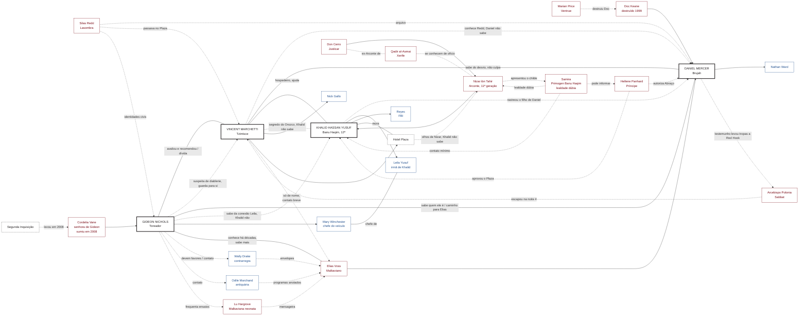

#narrador #relationship-map #auld-sanguine #jogador

# Auld Sanguine: Laços entre Jogadores

> Cruzamento dos backgrounds de [[Gideon Nicols]], [[Vincent Marchetti]], [[Daniel Mercer]] e [[Khalid Hassan Yusuf]]. Primeira rodada com quatro PCs; o Gangrel e os demais jogadores entram depois.
> Método e convenções em [[mapas-de-relacionamento]].

## Sumário
- [[#Como ler este arquivo]]
- [[#Premissas fechadas]]
- [[#Quem sabe o quê]]
- [[#Eixo comum: Nova York, 1999]]
- [[#Laços entre os PCs]]
- [[#O Plaza: Khalid é residente]]
- [[#Nizar, Don Cerro e Samira]]
- [[#Impacto na corte de Nova York]]
- [[#O veículo: onde Leila trabalha]]
- [[#NPCs compartilhados]]
- [[#Gusman Gutierrez: elo de 2018 (em construção)]]
- [[#Nina Calloway: elo com a coterie]]
- [[#Herta Müller: a hóspede da comitiva]]
- [[#O que os quatro têm em comum]]
- [[#Mapa (Mermaid)]]
- [[#Perguntas em aberto]]
- [[#Inconsistências a resolver]]
- [[#Fontes]]

---

## Como ler este arquivo

| Marca | Significado |
|---|---|
| ✅ **Decidido** | Escolhido pelo Narrador (Enzo) |
| 📄 **Texto** | Já está escrito nos backgrounds |
| 💡 **Proposto** | Ponte criada a partir dos textos; ainda precisa de aprovação |
| 🔒 **Assimetria** | Um lado sabe e o outro não; não revelar na mesa sem querer |

---

## Premissas fechadas

- ✅ **Os quatro são uma coterie e já se conhecem.** Os laços são cinzentos: ninguém é melhor amigo de ninguém, mas todos têm história com todos.
- ✅ **Tudo está alinhado em 2021.** A nota de Vincent já foi corrigida (era 2022).
- ✅ Para o aliado do Khalid, use só **Reyes** (nunca "Daniel Reyes"). A nota de Khalid já foi corrigida.
- ✅ Vincent é **ex-Sabbat** e isso faz parte da relação com os outros.
- ✅ **Khalid é 12ª geração** (era 13ª na ficha). O sire, **Nizar ibn Tahir**, é **11ª geração**, ancilla e **Arconte do Justicar Don Cerro**.
- ✅ **Ninguém na coterie conhece a identidade do sire de Khalid.** Khalid sabe e a guarda. Gideon suspeita de alguém do alto escalão, sem saber o quanto; só sabe que a Primogen dos Banu Haqim (Samira) é a ponte, e só tem certeza de que **não é ela**.
- Regra de mesa: nada é jogado contra um personagem de outro jogador sem consentimento.

## Quem sabe o quê

Lista de assimetrias, para o Narrador não vazar nada sem querer.

| Segredo / informação | Sabe | Não sabe |
|---|---|---|
| Gideon recomendou Vincent em 1999 | Gideon, Vincent ✅ | |
| **Sensação** de diablerie em Vincent (percebida com os anos, não em 1999) | Gideon 🔒 ✅ (sem certeza) | Vincent, Khalid, Daniel |
| Vincent bebeu do corpo de Orozco | Vincent | Gideon (só suspeita), Khalid, Daniel |
| Vincent conhece **Silas Redd** | Vincent 🔒 ✅ | Daniel (não sabe que Vincent o conhece), Khalid |
| Daniel teve papel no **desvio de tropas** (ver [[#O desvio de tropas: o que cada um sabe]]) | Vincent ✅, Gideon ✅ | |
| **Gideon liga o testemunho de Daniel à fuga de Polonia** (inferência) | Gideon 💡 | Daniel?, Vincent? (Vincent sabe só que a rota abriu) |
| A repórter de Gideon, **Mary Winchester**, chefia o veículo onde **Leila** trabalha | Gideon 🔒 ✅ | **Khalid** (não faz ideia) |
| Quem Daniel é na Camarilla | Gideon ✅ | |
| **Elias Voss**: reputação, aparência, modo de trabalhar, intermediários e por onde começar a busca | **Gideon** ✅ (conhece há décadas; contatos 💡) | Vincent (só nome e reputação), Khalid?, Daniel (sabe dos próprios contatos e que Gideon é o caminho) |
| **Elias Voss**: nome, reputação e que interveio no julgamento de Daniel; contato breve em 1999 💡 | Vincent ✅ | Detalhes do julgamento e do vínculo com Daniel; intermediários; paradeiro |
| **Paradeiro atual de Elias Voss** | Narrador (em aberto) | Todos os jogadores |
| Khalid **pesquisou** os outros três ao longo dos anos | Khalid ✅ | Gideon, Vincent, Daniel |
| Khalid sabe do **filho de Daniel** (rastreou por registros de hospital) | Khalid 🔒 ✅ | Daniel |
| **Quem é o sire de Khalid** (Nizar ibn Tahir, Arconte de Don Cerro) | **Khalid** 🔒 ✅ (guarda a identidade), Nizar | Vincent, Daniel, Gideon (só **suspeita** de alguém do alto escalão, sem saber o quanto) |
| **Samira é a ponte** entre o sire e a corte de NY | Gideon ✅, Khalid | Vincent?, Daniel? |
| **Samira não é a sire de Khalid** | Gideon ✅ (única certeza dele), Khalid | |
| **O Plaza é uma extensão do alcance de Nizar** (olhos dele, via Khalid; mecanismo: fornecedor + ligação) | Nizar ✅ | **Khalid** (não sabe), Vincent 💡, coterie, corte de Panhard |
| **Lealdade de Samira é dúbia** | Narrador ✅ | Todos os jogadores; Khalid teve pouco contato com ela |
| Nizar é **Arconte** | Khalid ✅, Qadir 💡 | Gideon (só suspeita de "alto escalão"), Vincent, Daniel |
| **Cordelia Vane desapareceu em 2008** (Segunda Inquisição) | Gideon ✅, quem acompanha a corte 💡 | Se está morta ou presa: **ninguém** |

> 🧩 **Dica Para o Narrador**
> A assimetria que mais pesa é a de Nathan. A proteção que Elias montou em volta dele (sobrenome Ward, fichas queimadas) aguentou todos os inimigos de Daniel e **não aguentou um investigador com acesso a registros**. A segunda é o Plaza: o investigador da coterie é, sem saber, o vigiado.

---

## Eixo comum: Nova York, 1999

Três dos PCs estiveram na mesma guerra por lados diferentes. A Batalha durou **cinco dias**, e o Sabbat já estava quebrado nas duas ou três primeiras noites. As "noites" de Daniel e Vincent são só o recorte pessoal de cada um.

| Noite | Vincent 📄 | Daniel 📄 | Gideon |
|---|---|---|---|
| Antes | Entrega livros, nomes, lista de havens e horários de sono; leva a oferta aos Giovanni | Doc monta a Segunda Guarda; Daniel carrega ordens e cargas achando que é reserva da Camarilla | Mapeia refúgios e movimentos do Sabbat pelos bastidores da Broadway 📄 |
| 1 | Incêndios nos havens de dia | Entregas, reconhecimento de rotas | ✅ Ele e Vincent se ajudam: informação de refúgios de um lado, a lista do outro |
| 2 | Orozco é morto num trem em Grand Central | Claire morre; a letra de Doc na folha | ✅ Já avaliou e recomendou Vincent à Camarilla |
| 3 | Cerco ao complexo do Bronx começa | Daniel é capturado em Red Hook e julgado; Elias o defende | |
| 4 | Bronx cai; **Polonia e um templar escapam por uma rota que ele pediu para fechar** | **Doc é destruído em Red Hook por uma força de Marian Price**; Torch foge | |
| Depois | Herói de guerra da Camarilla | Liberado sob supervisão; parte como Nomad | Reconhecimento entre alguns anciões 📄 |

> 🧩 **Dica Para o Narrador**
> A noite 4 é a ponte entre Vincent e Daniel: o "único erro" de Vincent (comandantes mandaram a tropa para outro lugar e deixaram a rota aberta) pode ter sido **a resposta ao golpe de Doc em Red Hook**. Vincent **sabe** que Daniel teve papel no desvio, mas ✅ **não o culpa**.

---

### O desvio de tropas: o que cada um sabe
> 💡 Redação do Narrador (16/10/2026) para esclarecer o "desvio de tropas" citado nos laços. Vale confirmar com Enzo; o texto de Vincent ainda usa a versão curta.

"Desvio de tropas" aparece em duas coisas ligadas, e a confusão vem de misturá-las:

1. **O desvio de Doc (a Segunda Guarda).** Durante a Batalha, Doc Keane, Brujah do Iron Lanterns, monta uma suposta "reserva" da Camarilla. Na prática, **desvia veículos, armas e rotas de evacuação** para uma equipe própria e ocupa um depósito em Red Hook. Daniel, sem saber o objetivo político, **leva ordens e cargas** (Maggie, caminhonetes da oficina). Na terceira noite é **preso** com ordens falsas no bolso.
2. **O redirecionamento da Camarilla.** O **depoimento de Daniel** (e as provas de Ivo Rask, a exigência de Elias) revela os abrigos da Segunda Guarda. Na noite seguinte, a Camarilla **cerca Red Hook** com uma força comandada por **Marian Price**, e **Doc é destruído**. Para isso, os comandantes **tiram tropas do cerco do Bronx**, onde o arcebispo Polonia estava acuado. A rota que Vincent pedira para fechar fica aberta e **Polonia e um templar escapam**.

| Quem | O que sabe |
|---|---|
| **Daniel** | Os dois passos 1 e 2. Não sabe necessariamente que o passo 2 abriu a fuga de Polonia. |
| **Vincent** ✅ | Sabe que Daniel teve envolvimento e **não o culpa**. Sabe da rota aberta e atribui o erro aos comandantes. |
| **Gideon** ✅ | Sabe do passo 1 e do julgamento (fatos de circulação entre anciões). Seus informantes viram o cordão do Bronx afinar na noite 4, e ele **infere** a ligação com Daniel (💡 inferência, não confirmada). |
| **Khalid** | Esteve ausente (Abraçado em 2010). Só sabe que Daniel esteve na guerra de 1999. |

> 🧩 **Dica Para o Narrador**
> A inferência de Gideon é a chave: ele sabe uma coisa que Daniel talvez ignore, e que Vincent entende de outro ângulo. Se Daniel descobrir que o testemunho que o salvou também deixou Polonia escapar, a Convicção *"Nunca use a família de alguém como arma"* e a culpa por Doc passam a disputar o mesmo lugar.

## Laços entre os PCs

Os seis pares possíveis. Cada um tem um lado positivo e um negativo, como pede o Core.

### Gideon ↔ Vincent: a dívida e o silêncio
- ✅ Eles se conheceram e se ajudaram na Batalha de Nova York.
- ✅ **Gideon avaliou Vincent em 1999, junto com Cordelia Vane, sua sire na época, e o recomendou** à Camarilla (decisão do Narrador, 17/10/2026). Isso cria uma **dívida relativa**: Vincent deve a Gideon ter sido aceito, mas sabe que Gideon também se beneficiou do que ele entregou.
- ✅ **Gideon não viu nada de estranho em 1999.** Foi com os **anos** que percebeu algo no Vincent, e hoje tem uma **sensação**, sem certeza, de que isso tem relação com **diablerie**. Ele **guarda para si**. Vincent não sabe que Gideon desconfia. 🔒
- ✅ O **Plaza** é cenário natural das festas de Gideon. Por isso Gideon conhece a Broadway por dentro e o Plaza por dentro, e Vincent conhece os dois lados.
- ✅ Os dois **se encontram regularmente**.
- 📄 Ambos foram Abraçados por utilidade e vigiam à distância um mortal que ama (a jornalista; Nick Gallo).
- 💡 Gideon tem uma carta que nunca usou. Vincent tem uma dívida que nunca cobrou. Os dois sabem disso sem dizer.

### Gideon ↔ Daniel: o corretor e quem procura Elias
- ✅ Gideon **sabe quem Daniel é na Camarilla** (o homem que testemunhou contra o sire e foi salvo por Elias).
- ✅ Gideon sabe do **envolvimento de Daniel no desvio de tropas**. O que isso quer dizer, passo a passo, está em [[#O desvio de tropas: o que cada um sabe]].
- ✅ Daniel **pensa em Gideon como o caminho para achar Elias Voss.**
- ✅ **Gideon conhece Elias há décadas** e sabe mais dele que Vincent. Fala com ele quase sempre por intermediários e **não sabe onde ele está hoje**.
- 💡 **Pontos de partida de Gideon** (contatos inventados, a validar): 👤 **Wally Drake** (contrarregra de um teatro no West Village; Elias deixa envelopes "para o Cartógrafo"; Wally deve um favor a Gideon), 👤 **Odile Marchand** (antiquária de programas antigos; recebe programas com margens anotadas por Elias), 🩸 **Lu Hargrove** (Malkaviana neonata, atriz; já foi mensageira de Elias). Nenhum sabe o paradeiro atual; as pistas **complementam** as de Daniel (oficina, livreiro, Ivo Rask). Detalhe em [[Gideon Nicols#Elias Voss: o que Gideon sabe]].
- 📄 Em 1999, Daniel localizou refúgios do Sabbat e reconheceu uma rota do arquivo vazado; Gideon fazia o mesmo trabalho por outro caminho.
- 📄 O arquivo de Doc/Silas Redd cruzava identidades vampíricas com civis: o disfarce de produtor de Gideon pode ter estado ali. 💡 (Gideon não sabe do arquivo.)
- 💡 **Positivo:** Gideon é intermediário de favores e é o caminho mais concreto até Elias. Também pode abrir a audiência com Panhard sobre o Abraço de Nathan.
- 💡 **Negativo:** Gideon sabe o que Daniel carrega e pode cobrar por isso. Ajudar na busca custa um favor, uma informação ou algo de Daniel.
- 💡 **Gancho de cena:** a busca passa por três cenas curtas (teatro, antiquário, ensaio), cada uma com uma peça que se cruza com as pistas de Daniel. O paradeiro de Elias fica em aberto.

### Gideon ↔ Khalid: a repórter que Khalid não sabe que existe
- ✅ A jornalista de Gideon é **Mary Winchester** (nome dado pelo Narrador). Ela **não é Leila**: é **chefe de um veículo investigativo**, e **Leila trabalha lá**.
- ✅ **Gideon sabe disso. Khalid não faz ideia** de que na redação da irmã trabalha alguém querido e importante para Gideon. 🔒
- 💡 **Gideon sabe que Leila é irmã de Khalid** (como descobriu fica em aberto).
- ✅ Sobre o sire: **Gideon só sabe que Samira, a Primogen dos Banu Haqim, foi a ponte**, tem certeza de que **não é ela** a sire e suspeita de alguém do alto escalão. Khalid sabe a identidade e a guarda.
- Detalhes do veículo em [[#O veículo: onde Leila trabalha]].
- 💡 **Positivo:** Gideon tem motivo para proteger Leila (ela trabalha com quem ele ama), e por tabela protege o que Khalid mais valoriza.
- 💡 **Negativo:** Gideon guarda uma informação sensível sobre Khalid. Se Khalid descobrir que Gideon sabia e calou, o laço racha.

### Vincent ↔ Daniel: lados opostos da mesma guerra
- ✅ **Lados opostos:** Vincent deu o plano da Camarilla; Daniel foi usado por um sire que quis lucrar com a mesma guerra.
- ✅ Vincent é ex-Sabbat; Daniel carrega a lembrança de Doc entregando famílias ao Sabbat.
- ✅ **Vincent sabe quem era Silas Redd.** Daniel **não sabe que Vincent o conhece**. 🔒 (Como porteiro do Plaza, viu o Lasombra subir ao quinto andar.)
- ✅ **Vincent sabe que Daniel teve envolvimento no desvio de tropas, mas não o culpa.**
- ✅ Ambos têm **desejo de acabar a guerra** (Vincent, pegar Polonia; Daniel, proteger Nathan do que Doc deixou).
- 💡 **Positivo:** a única pessoa que pode ajudar Daniel a achar a cópia do arquivo é a que não pode dizer de onde conhece Redd.
- 💡 **Negativo:** quanto mais Daniel procurar Redd, mais perto chega do Plaza.

### Vincent ↔ Khalid: o hóspede permanente
- ✅ **Khalid não sabe de nada do que Vincent fez com o corpo de Orozco.** Se descobrir, talvez reaja (Convicção contra tiranos, Compulsion de Judgment). 🔒
- ✅ **Khalid é residente permanente no Plaza.** Vincent foi encarregado pela Camarilla de ajudá-lo. Ver [[#O Plaza: Khalid é residente]].
- 💡 **Positivo:** Khalid conhece segurança por dentro e vive entre as câmeras do hotel; Vincent precisa de olhos.
- 💡 **Negativo:** Khalid mora no mesmo prédio que o segredo de Vincent, e é o PC mais bem equipado para descobrir. E o sire dele pode estar vendo por cima do ombro dele.

### Khalid ↔ Daniel: o que um sabe do outro
- ✅ **Khalid sabe mais sobre Daniel do que Daniel sabe sobre Khalid.**
- ✅ Ao longo dos 11 anos desde o Abraço, Khalid **pesquisou os outros membros da coterie** (Vincent, Gideon, Daniel).
- ✅ **Daniel é o mais fácil** de rastrear, por ter sido Abraçado mais recentemente (1993) e porque **o filho tem registros em hospitais**. Khalid fez um **trace back** que chega a Nathan. 🔒
- 📄 Eles têm poucas ligações diretas além disso: não são próximos.
- 💡 **Positivo:** os contatos de Khalid (Reyes, o detetive do NYPD, o técnico de câmeras) servem para achar Elias e Silas Redd.
- 💡 **Negativo:** o que Khalid sabe de Nathan é uma ferida aberta na proteção de Daniel. A Convicção de Daniel, *"Nunca use a família de alguém como arma"*, é a que mais vai pesar quando ele descobrir.

---

## O Plaza: Khalid é residente

✅ Khalid mora de forma permanente no Plaza, hotel de Vincent, por designação das forças da Camarilla em Nova York. O sire dele é poderoso e importante, mas distante: ele viaja e ensinou o que quis, e confiou o childe ao domínio do Plaza para Vincent ajudá-lo.

**Como Khalid foi parar lá** 💡
1. **2010, Washington D.C.:** Nizar Abraça Khalid. Um Arconte não leva um childe recém-criado para campo. Precisa de um domínio estável.
2. **Intermediação:** Nizar usa **Samira**, Primogen Banu Haqim de Nova York, para apresentar o childe à corte (ver [[#Nizar, Don Cerro e Samira]]).
3. **Escolha do Plaza:** a corte de NY aprova porque Vincent é herói de guerra confiável, o hotel é um domínio estável e discreto, e não pertence a nenhum Primogen.
4. **Khalid chega em 2011 ou 2012** 💡, a "ficar até saber se é útil". Está lá há cerca de dez anos.
5. **Cobertura:** consultor de segurança do hotel (usa a credencial falsa de segurança privada). Dá motivo para circular pelas câmeras.

### O Plaza como "olhos de Nizar" 🔒

✅ **Decidido:** o Plaza é uma **extensão do alcance de Nizar**. Khalid funciona como os olhos dele **sem saber**. A lógica: o Plaza é importante o bastante para valer a atenção de um Arconte (hotel de luxo, herói de guerra, trânsito de Kindred de todas as seitas), mas não importante o bastante para ser vigiado diretamente pela corte de Panhard.

✅ **Mecanismos escolhidos (15/10/2026):** o fornecedor e a ligação.
- ✅ **O fornecedor.** Como consultor de segurança, Khalid escolheu o sistema de câmeras e o fornecedor do hotel **por indicação de Nizar**. O sistema tem uma porta dos fundos que Nizar controla. A ironia é cruel: o ex-Homeland Security é o vigiado.
- ✅ **A ligação.** Nizar liga de vez em quando e pergunta "como está o hotel, quem passou por aí", como um sire distante faria. Khalid responde de boa-fé e sem filtro.
- ~~A equipe (funcionário pago por Nizar)~~: descartada. Pode voltar como escalada se Khalid descobrir o fornecedor.
- 🔒 **O que o jogador de Khalid sabe:** que Nizar indicou o fornecedor e que liga de vez em quando perguntando do hotel. **Não sabe** que isso é vigilância. Está no README dele como fatos soltos.

**Consequências para o jogo** 💡
- Tudo que acontece no Plaza (as festas de Gideon, as visitas, Vincent e seus segredos) pode chegar a Nizar, e dele a Don Cerro.
- Se Khalid descobrir, é a mesma estrutura do que ele sente pelo sire: *dar sem cobrar, cobrar depois.* Ele vai se sentir usado pela segunda vez pela mesma pessoa.
- Vincent pode ser surpreendido: a Camarilla lhe confiou o hóspede como favor, e ele não sabe que também vira posto avançado de um Arconte.

---

## Nizar, Don Cerro e Samira

### Nizar ibn Tahir
- ✅ Banu Haqim, **11ª geração, ancilla**, **Arconte do Justicar Don Cerro**.
- 📄 Benfeitor da família Yusuf no Oriente Médio, depois sire de Khalid (Abraço em 2010, D.C.). Na ficha, Mawla (1).
- 💡 Origem no Oriente Médio, ligado à aliança entre os Banu Haqim da região e a Camarilla. Isso explica o resgate da família e o interesse em um agente humano que conhecesse agências de segurança.
- 💡 **Poder real:** Nizar tem sangue forte (11ª, Blood Potency alto) e autoridade delegada de um Justicar. Isso é mais do que qualquer um na coterie.
- ✅ **Identidade secreta.** Khalid sabe quem é o sire e **guarda isso dos outros três**. Gideon suspeita de alguém do alto escalão, sem saber o quanto. Nizar nunca aparece na mesa pelo nome.

### Justicar Don Cerro
- ✅ Superior de Nizar.
- 📄 Qadir al-Asmai foi Arconte dele em Londres ([[Personagens da Camarilla de NY#Qadir al-Asmai]]). Os dois **se conhecem de ofício**, o que cria uma ponte entre o Xerife e o sire de Khalid. 💡

### Samira (Primogen Banu Haqim)
- ✅ **A lealdade dela é dúbia e os jogadores não sabem disso.**
- ✅ **Khalid teve pouco contato com ela.** Ela o apresentou à corte e depois ficou distante.
- 💡 Possíveis versões da lealdade (o Narrador escolhe e mantém aberto):
  1. Leal a Nizar, mas fala com Panhard sobre tudo que Khalid faz.
  2. Rival de Nizar dentro do clã; acolheu Khalid para ter uma carta contra ele.
  3. Tem agenda própria (por exemplo, quer um Justicar Banu Haqim).
- 💡 Samira respeita Julia Sowinski ([[Personagens da Camarilla de NY]]): pode se aproximar de Khalid se algo envolver a Primogen Lasombra.

---
- ✅ **Gideon sabe que Samira é a ponte** entre o sire de Khalid e a corte de NY, e tem certeza de que **ela não é o sire**. Isso é tudo que ele tem. Qualquer versão da lealdade dela precisa conviver com isso.

## Impacto na corte de Nova York

Tudo aqui é proposta (💡). Nada contradiz as fontes que li; o V5 não traz um Justicar Banu Haqim nem regras de Arconte que eu tenha podido ler.

| Quem | Impacto |
|---|---|
| **Hellene Panhard** (Príncipe) | O poder dela está em queda, mas só quem está muito bem informado dentro da corte e enxerga o quadro maior percebe isso; para a maioria, ela governa com firmeza. Ela aceitou o Plaza sem ver que ali havia um posto de Arconte; se descobrir, vai sentir o Justicar espionando-a. Um Justicar pode depô-la. |
| **Qadir al-Asmai** (Xerife) | Ex-Arconte de Don Cerro; pode reconhecer o estilo de Nizar num caso do Plaza. Ele já pensa em partir, e a presença de um Arconte pode precipitar isso (ou fazê-lo ficar). ✅ Também é, com Arturo, uma das duas maiores autoridades Toreador da cidade e responde, em teoria, politicamente por Gideon. |
| **Samira** (Primogen Banu Haqim) | Peça solta. Pode virar informante de Panhard ou ponte para Nizar. |
| **Valerie Duval** (Scourge) | Qualquer incidente com thin-bloods no Plaza chama um Arconte, e ela não quer isso. |
| **Thomas Arturo** (Herald) | Corretor de reputação; pode vender o que souber sobre o childe do Arconte. ✅ Também é, com Qadir, autoridade Toreador e responde, em teoria, politicamente por Gideon. |
| **Vincent** | Ganha proteção e um favor de Nizar, mas tem um fiscal em casa. O segredo do Orozco passa a ter um destinatário potencial (Don Cerro). |
| **Gideon** | ✅ Sem sire (Cordelia desapareceu em 2008) e **sem Primogen Toreador** na cidade em 2021, **não reporta diretamente a ninguém**. A responsabilidade política dele recai, em teoria, sobre Arturo e Qadir, mas ele tem liberdade pela idade (78 anos) e pela contribuição na Batalha de 1999. Corretor de informação: pode perceber o alcance de Nizar e vender ou usar isso. |
| **Daniel** | Poder pedir ao Gideon uma audiência com Panhard fica mais delicado: a corte está atenta a quem anda com um childe de Arconte. |
| **Khalid** | Protegido pela ligação, mas peão sem saber. Se descobrir, a Convicção "A verdade precisa vir à tona" se volta contra o próprio sire. |

> 🧩 **Dica Para o Narrador**
> Mantenha **Nizar fora de cena** na maior parte do tempo. Ele é pressão e ameaça, não solução. Se ele resolver os problemas dos PCs, a coterie perde o protagonismo. O Réveillon de 2021 pode ter uma mensagem dele, mas não a presença.

---

## O veículo: onde Leila trabalha

✅ A repórter de Gideon, **Mary Winchester**, é chefe do ***The Harbor Ledger***, veículo jornalístico investigativo. Leila trabalha lá. Khalid sabe o nome da redação onde a irmã trabalha, mas **não sabe** que Mary é chefe dela nem que Gideon a conhece. ✅ Nome aprovado pelo Narrador em 16/10/2026 (ainda inventado: conferir se não existe um com o mesmo nome antes de usar na mesa).

### Proposta: *The Harbor Ledger* 💡 (inventado)

Redação pequena e sem fins lucrativos, de jornalismo investigativo local, com sede no Lower Manhattan. Cobre habitação, polícia, contratos públicos e o porto. Financiada por fundações e doações de leitores, e publica em parceria com outras redações da cidade.

- **Modelo real:** imita redações sem fins lucrativos que existem em Nova York, como *The City*, *Documented* e as parcerias locais da *ProPublica* ([fontes abaixo](#fontes)). O nome *The Harbor Ledger* é inventado. Se for usar o nome na mesa, confira se não existe um com o mesmo nome.
- **A repórter de Gideon:** ✅ **Mary Winchester**, editora-chefe ou cofundadora do veículo. Foi a jovem repórter que ele conheceu nos anos 2000.
- **Leila:** repórter investigativa na redação, sob Mary.
- **Por que serve ao jogo:** Leila é Touchstone do Khalid. A redação dela está a uma pauta de investigar algo que cruze com os quatro: o porto (Giovanni, Red Hook), registros do Plaza, as famílias da Chama.

### Alternativa canônica
O *Shadows of New York* tem como mortal de Julia Sowinski (Primogen Lasombra) o veículo *New York Lodestar* ([[Personagens da Camarilla de NY#Julia Sowinski]]). Usar esse nome ligaria Leila à corte, o que complica mais do que ajuda.

---

## NPCs compartilhados

| NPC | Aparece em | Papel de ponte |
|---|---|---|
| **Elias Voss** (Malkaviano, "O Cartógrafo") | Daniel 📄, Gideon, Vincent | ✅ Daniel acha que Gideon é o caminho; Gideon o conhece há décadas e sabe mais que Vincent; Vincent só de nome e de um contato breve 💡; Khalid pode localizá-lo |
| **Wally Drake**, **Odile Marchand**, **Lu Hargrove** | Gideon 💡 (inventados) | Intermediários de Elias; pontos de partida para a busca |
| **Silas Redd** (Lasombra, intermediário do Sabbat) | Daniel 📄 | ✅ Vincent o conhece (Daniel não sabe); o arquivo expôs identidades civis (Gideon) |
| **Marian Price** (Ventrue, oficial de campo) | Daniel 📄 | 💡 Comandou a força que destruiu Doc na noite em que Polonia escapou; Gideon sabe |
| **Arcebispo Polonia** | Vincent 📄 | Ambição de Vincent; ligado indiretamente ao desvio de Red Hook |
| **Calebros** (Nosferatu, Príncipe provisório) | Daniel 📄 | Ajudou a sustentar o julgamento |
| **Ivo Rask** (Nosferatu) | Daniel 📄 | Guardou as provas; caminho para Elias pela rede Nosferatu |
| **Hellene Panhard** (Príncipe) | Daniel 📄 | Autoridade do Abraço de Nathan; aprovou a alocação de Khalid no Plaza 💡 |
| **Qadir al-Asmai** (Xerife) | Daniel 📄 | Origem da missão do Gangrel; ex-Arconte de Don Cerro, conhece Nizar de ofício 💡 |
| **Samira** (Primogen Banu Haqim) | Notas de NY | ✅ Lealdade dúbia; Khalid a conhece pouco; Gideon sabe que é a ponte |
| **Nizar ibn Tahir** | Khalid 📄 | ✅ 11ª geração, ancilla, Arconte de Don Cerro |
| **Don Cerro** (Justicar) | Notas de NY | ✅ Superior de Nizar |
| **Leila Yusuf** | Khalid 📄 | ✅ Trabalha na redação de Mary Winchester |
| **Mary Winchester** | Gideon 📄 | ✅ Chefe do veículo onde Leila trabalha; Touchstone candidata de Gideon |
| **Cordelia Vane** | Gideon (nome dado pelo Narrador) | ✅ Senhora de Gideon; levada pela Segunda Inquisição em 2008, morta ou capturada |
| **Reyes** (FBI) | Khalid 📄 | Aliado de Khalid |
| **Nick Gallo** | Vincent 📄 | Recepcionista do Plaza; Khalid mora no mesmo prédio |
| **Nathan Ward** | Daniel 📄 | ✅ Khalid rastreou |

---

## Gusman Gutierrez: elo de 2018 (em construção)

> 💡 **Rascunho.** O quinto jogador (Oliveira) entra por **um elo decidido**: **Gideon e Khalid acharam Gusman no metrô em 2018**, e **os três (com Vincent)** esconderam a identidade dele, **inclusive dele mesmo**. Detalhes em [[Gusman Gutierrez#A noite de 2018: o achado no metrô]]. O mapa Mermaid **ainda não** inclui Gusman. ✅ **Daniel fica de fora** (decisão do Narrador, 16/10/2026).

| Elo | Situação |
|---|---|
| ✅ **Gusman acordou numa estação do metrô de NY, no meio da noite, já Abraçado.** O sire é desconhecido para todos e **não será escrito**. | Decidido pelo Narrador. |
| ✅ **Khalid e Gideon o acharam**, procurando um Ravnos sobrevivente da Semana de Pesadelos. | Decidido pelo Narrador. |
| ✅ **O Abraço deixou uma marca escrita** (sânscrito + marca de Caim + ar de Sabbat) que **ninguém decifrou**. | Decidido e **validado** pelo Narrador. |
| ✅ **Khalid viu na gravação** uma figura encapuzada que escreve a marca, olha a câmera **com meio sorriso** e a **câmera corta**. | Decidido e **validado** pelo Narrador. |
| ✅ **Gideon e Khalid contam a Vincent.** Gideon argumenta contra expor Gusman à Camarilla (sem provas, para não causar alarde; **informação vale ouro**). Os três **guardam segredo**. **Vincent sabe que Gusman é Ravnos.** | Decidido e **validado** pelo Narrador. |
| ✅ **Gideon é o responsável por Gusman** (Mawla). | Decidido pelo Narrador. |
| ✅ **Khalid rastreia a origem** e, em 1 ou 2 anos, acha o **nome verdadeiro** (Julian Jiménez) e **informa Gideon**. Sabe onde Julius mora e onde Mike esteve preso (Mike só saiu em **2020**). | Decidido e **validado** pelo Narrador. |
| ✅ **Só Gideon tem uma vaga ideia** de que saber o nome verdadeiro de um Ravnos dá controle (maldição *Unbirth Name*). **Khalid e Vincent não têm esse conhecimento.** Quando Gideon usa o nome, **sente Gusman ceder**. | Decidido pelo Narrador (16/10/2026). |
| ✅ **Nem o próprio Gusman sabe que é Ravnos.** Gideon, Khalid e Vincent lhe **explicaram que ele é provavelmente um Caitiff**. Se perguntado, ele diz **com sinceridade** que não sabe de que "tipo de vampiro" é. **Ninguém de fora sabe que ele é Ravnos.** Ele **evita Kindred**. | Decidido pelo Narrador (16/10/2026), **substitui** a versão anterior ("Gusman se passa por Caitiff por instrução de Gideon"). |
| ✅ **Só um Kindred de fora sabe que Gusman existe: Iggy**, barman Malkaviano, Anarquista independente (quase Autarkis), lunático. Gusman **não tem certeza** de que Iggy é Kindred. Nenhum servo de Gideon sabe. | Decidido pelo Narrador (16/10/2026). 💡 Nome e bar (*The Broken Minute*) inventados por mim. |
| ✅ **Pavio Negro MC:** Gusman o conhece de bares na vida mortal; **não sabe** da história do clube nem da relação com Daniel. Os Anarquistas da ilha **não sabem** dele. | Decidido pelo Narrador (16/10/2026). |
| ✅ **Alimentação:** bolsas desviadas pelos três; depois **Marcus Bell** (enfermeiro) por uma **ponte de Gideon** (**Tessa Lang**, artista que o namora). Hoje independente. | Decidido e **validado** pelo Narrador. |
| ✅ **Gusman sabe quase nada** da sociedade vampírica. | Decidido pelo Narrador. |
| ✅ **Gusman mora em Staten Island.** | Decidido pelo Narrador. Ver [[Gusman Gutierrez#Onde ele mora]]. |
| ✅ **Os italianos (máfia) odeiam Gusman** por algo que ele fez quando mortal: um golpe contra a filha de um membro. | Decidido pelo Narrador (16/10/2026). 💡 Detalhes (Submariner, Gianna Bellandi) em [[Gusman Gutierrez#Os italianos: o golpe do Submariner]]. |
| ✅ **Mike esteve preso de 2016 a 2020.** | Decidido pelo Narrador (16/10/2026). |
| ✅ **Casa Santa Rita** (Newark, fechada em 2016) é o orfanato. | Decreto do Narrador (16/10/2026). |
| 💡 **Gusman não sabe** que Gideon procurava um Ravnos. | Proposta. |
| ❓ **Quando e como os três lhe explicaram o "Caitiff"**, e o que cada um fará se ele perguntar direto. | Aberto; decidir com os jogadores de Gideon, Khalid e Vincent. |

**Assimetrias para a tabela de [[#Quem sabe o quê]]:**
- **Que Gusman existe:** **Gideon, Khalid, Vincent** ✅ e **Iggy** (único Kindred de fora) ✅ | **Daniel** ✅, a corte em geral.
- **Que Gusman é Ravnos:** **Gideon, Khalid, Vincent** ✅ | **Gusman** ✅ (acredita ser Caitiff), Daniel, **todo o resto** ✅ (inclusive Iggy).
- **O nome verdadeiro de Gusman (Julian Jiménez):** **Gusman, Gideon, Khalid** ✅, Mike e Julius | **Vincent**, Daniel, a corte.
- **O que o nome permite (maldição *Unbirth Name*):** **Gideon**, só uma vaga impressão ✅ | **Khalid**, **Vincent**, Daniel, a corte. **Gusman** sabe que cede, mas **não conhece a maldição nem o clã** ✅.
- **O significado da marca:** ninguém.
- **Quem é o sire / a figura da gravação:** ninguém.
- **Que o achado foi parte de uma busca por um Ravnos:** Gideon, Khalid | Gusman, Vincent (💡), Daniel.
- **Que a explicação "Caitiff" foi dita a Gusman para esconder o clã:** Gideon, Khalid, Vincent | Gusman, Daniel, a corte.
- **A gravação:** Khalid, Gideon, Vincent (em parte) | Gusman.
- **O golpe contra os italianos:** Gusman, os italianos 💡 | os outros jogadores.
- **Iggy:** Gusman (com dúvida) | Gideon, Khalid, Vincent, Daniel.

**Riscos políticos (⚠️):** esconder um Abraço sem apresentá-lo à corte contraria a **Terceira Tradição (Progeny)**. **Gideon** (responsável) responde a **Arturo** e **Qadir**, em teoria. **Qadir é o Xerife** de Nova York; **Vincent** perde o que arrisca como herói de guerra; **Khalid** tem Status 1. 💡 Descoberto como **Caitiff sem apresentação** é uma ofensa; como **Ravnos escondido por três anos**, muito pior. ⚠️ **Risco interno:** se Gusman descobrir que os três lhe esconderam o clã, a confiança em Gideon (e em Khalid e Vincent) quebra.

**Sem ligação com Daniel:** Gusman mora em **Staten Island**, onde está o **Pavio Negro MC** da história de Daniel, mas **nenhum dos dois sabe** da conexão. Se se cruzarem, será por acaso.

**Arquivos atualizados (16/10/2026):** `Gideon Nicols.md`, `Khalid Hassan Yusuf.md`, `Vincent Marchetti.md` e os READMEs dos três, com o evento de 2018, o segredo dos três e a cobertura (**Gusman não sabe que é Ravnos**). **Só Gideon** recebeu a vaga impressão sobre o nome. O README do Daniel **não mudou**, porque ele fica de fora.

**Cronologia:** a Semana de Pesadelos foi em julho de 1999, 19 anos antes de 2018. Ver [[Semana de Pesadelos]].
## Nina Calloway: elo com a coterie

> ✅ = decidido pelo Narrador (16/10/2026). 💡 = proposta minha, a validar com Marcelle, Victor Polck e Klaus. **Não há mapa Mermaid para Nina**, por decisão do Narrador. Detalhes em [[Nina Calloway#Ligação com a coterie (one-shot)]].

| Elo | Situação |
|---|---|
| ✅ **Gideon Nicols é Mawla de Nina** (Toreador neonata, Abraço irregular de novembro de 2020, *Suspect*) **desde antes da one-shot**. | Decidido pelo Narrador. |
| ✅ **Gideon leva Nina ao Plaza vez ou outra.** Por isso ela **conhece pessoalmente Khalid e Vincent**. | Decidido pelo Narrador. |
| ✅ **Daniel e Gusman: Nina não os conhece** antes da noite. | Decidido pelo Narrador. |
| ✅ **Gatilho da one-shot:** Augie Mendez (aliado de Nina) pede ajuda por Isabella → Nina procura o Mawla → Gideon reúne a coterie. | Decidido pelo Narrador. O roteiro já aponta Augie como o "melhor encaixe". |
| ✅ **Gusman e Nina: sem proibição de encontro.** | Decidido pelo Narrador. |
| ✅ **Khalid: vínculo secundário** com Nina. | Decidido pelo Narrador. |
| 💡 **Motivos de Gideon:** cobrança de Arturo e Qadir ("Toreador jovem em apuros"), tirar a moeda de Arturo, espelho do método de Cordelia, território no Harlem. | Proposta. |
| 💡 **Cobertura de Gusman:** Nina é a pupila oficial e visível; Gusman, o escondido. Segredo privado de Gideon. | Proposta. |
| 💡 **Khalid na noite:** lidera a investigação (Pursuer); é o espelho de Nina (Abraçados sem escolha). | Proposta. |
| 💡 **Ganchos de campanha com Khalid:** Nizar e o sire de Nina; *The Harbor Ledger* (Mary e Leila); parentesco Altagracia **Reyes** e o **Reyes** do FBI. | Proposta, **não para a one-shot**. |
| 💡 **Vincent e Nina:** trato de visita no Plaza, o hotel dele; sem laço além disso. | Proposta. |
| ❓ Nina sabe de Gusman antes da noite? | Decidido 💡: não. |

**Assimetrias (💡):**
- **Que Nina é Mawla-dependente de Gideon:** a coterie e a corte ✅ (ela é a pupila **visível**).
- **Que Nina existe e é a pupila de Gideon:** Khalid e Vincent ✅ (conhecem das visitas ao Plaza) | **Daniel** e **Gusman** ✅ (não a conhecem).
- **Que Gusman existe:** Nina passa a saber na noite ⚠️ (era só Gideon, Khalid, Vincent e Iggy). Nina é vigiada pela corte.
- **O clã de Gusman:** Nina **não sabe**; o próprio Gusman também não.

**Riscos (⚠️):** quem vigia Nina vigia Gideon, e portanto chega perto de Gusman. Como Nina circula pelo **Plaza**, quem a vigia pode ir parar no hotel de Vincent, onde Gusman se escondeu nas primeiras semanas. Com Auspex 2 e Insight 3, Nina é a que mais provavelmente nota algo estranho nele.

## Herta Müller: a hóspede da comitiva

> ✅ = decidido pelo Narrador. 💡 = proposta minha, a validar com Rebeca, o jogador de Vincent e Klaus. **Não há mapa Mermaid para Herta**, por decisão do Narrador. Detalhes em [[Herta Müller#A comitiva: quem veio e quando]] e [[Herta Müller#Ligação com a coterie (one-shot)]].

| Elo | Situação |
|---|---|
| ✅ **A comitiva europeia se hospeda no Plaza** em 28/12; em 30/12 sai para uma residência da Príncipe, para as festas de fim de ano. **Só Herta fica**: na noite de 31, são três noites no hotel. | Decidido pelo Narrador. |
| ✅ **Vincent é encarregado de Herta**: Heinrich pediu a ele que a atendesse, e mandou Herta chamá-lo. | Decidido pelo Narrador. |
| ✅ **Khalid: ligação leve.** Moram no mesmo hotel e já se viram; pouco contato. | Decidido pelo Narrador. |
| 💡 **Membros:** Heinrich (Ventrue, chefe), **Teodoro Castellví** (Lasombra), Herta e **Lorenz Kehl** (carniçal). | Proposta. |
| 💡 **Datas:** chegada ter 28/12, Elysium qua 29/12, saída qui 30/12. | Proposta. |
| 💡 **Gideon, Daniel, Nina, Gusman:** não conhecem Herta antes da noite. | Proposta. |
| 💡 **Entrada na noite:** se a coterie se reunir no Plaza, Herta está lá, e Vincent pode chamá-la. | Proposta. |

**Assimetrias (🔒):**
- **Motivo da comitiva:** a corte, Vincent e Khalid conhecem o público (os Lasombra). O real (reassentamento de Kindred europeus) só Heinrich e Teodoro sabem; Herta tem uma pista.
- **As câmeras do Plaza:** a comitiva passou pelas câmeras com a porta dos fundos de Nizar (ver [[#O Plaza como "olhos de Nizar" 🔒]]). Gancho de campanha, não para o one-shot.

## O que os quatro têm em comum

- **Todos vigiam um mortal à distância**, sem se revelar: Gideon, a jornalista; Vincent, Nick Gallo; Daniel, Nathan; Khalid, a mãe e a irmã.
- **Quase todos têm um sire que os usou ou cobrou uma dívida**: senhora de Gideon, sire de Vincent, Doc, Nizar.
- **Todos conhecem alguém que desapareceu**: o sire de Vincent (Beckoning), Elias, a senhora de Gideon, Nizar (distante).
- **Convicções que se esbarram**: Daniel não usa família como arma; Vincent traiu quem estava com ele; Khalid não deixa tirano escapar.
- **Pessoas ligadas por baixo da mesa**: o veículo de Leila liga Gideon e Khalid sem que um saiba; o Plaza liga Vincent, Khalid e Nizar; Silas Redd liga Vincent e Daniel sem que um saiba.

---

## Mapa (Mermaid)

Convenções do Core: preto = PC, vermelho = outro Kindred, azul = mortal. Linha tracejada = proposto (💡) ou assimétrico; linha cheia = decidido ou escrito.

---

## Perguntas em aberto

**Para o Narrador**
- **Vincent sabe** que o Plaza é "olhos de Nizar"? Ou só descobre quando algo vazar? Hoje está como não sabe.
- ✅ Mecanismo do Plaza: fornecedor + ligação (escolhido).
- **Samira**: ✅ deixada em aberto de propósito (três versões em [[#Nizar, Don Cerro e Samira]]). Precisa caber no que Gideon sabe: ela é a ponte, mas não é a sire.
- Gideon **sabe que Leila é irmã do Khalid**? Como descobriu? E sabe que Khalid está "morto" para a família?
- Khalid vai **contar a Daniel** o que sabe de Nathan?
- Vincent **sabe que Daniel sabe** do desvio, ou só ele sabe?
- Gideon e Vincent **se encontram onde** (no Plaza, em estreias, em outro lugar)?
- Por que **Khalid esconde** a identidade do sire da coterie (medo, lealdade a Nizar, ordem dele, vergonha da dívida)? Decisão do jogador, se ele quiser.

**Para os jogadores**
- *Gideon:* a sensação sobre Vincent é de quê (cheiro, aura, comportamento)? Você já a testou? Como se chama a repórter e qual o veículo dela?
- *Vincent:* sua rota de fuga fechada foi aberta por causa de Red Hook? Você sabe que Gideon desconfia de algo?
- *Daniel:* como você reagiria se soubesse que Khalid rastreou Nathan?
- *Khalid:* você aceita ser 12ª geração (era 13ª) e filho de um Arconte? O que você faria com o que sabe de Nathan?

---

**Sobre Elias Voss (💡)**
- Os intermediários **Wally Drake, Odile Marchand e Lu Hargrove** (inventados) servem ao jogador de Gideon? Ele quer trocá-los ou nomeá-los de outro jeito?
- O contato breve de **Vincent com Elias em 1999** (rota traçada na margem de um papel) fica? Se sim, para onde a rota aponta?
- Onde está **Elias Voss** hoje? (Em aberto, só o Narrador decide.)
- Elias sabe algo sobre o **sumiço de Cordelia** em 2008?

## Inconsistências a resolver

- [x] Ano: tudo em 2021 ✅ (nota de Vincent corrigida).
- [x] Nome: usar **Reyes** ✅ (nota de Khalid corrigida).
- [x] Khalid, "quem o patrocina em NY": Nizar → Samira (apresentação) → Plaza ✅ (pendente de aprovação do jogador).
- [x] Quem conhece a identidade do sire ✅ (só Khalid; Gideon suspeita).
- [x] Senhora de Gideon: **Cordelia Vane**, levada pela Segunda Inquisição em 2008 ✅ (a validar com o jogador).
- [x] Jornalista de Gideon: **Mary Winchester** ✅. Confirmar a grafia ("Mary Win Winchester" na mensagem original).
- [ ] **Geração de Khalid:** 12ª em vez de 13ª. Conferir se a ficha (Blood Potency 1, 15 XP, Humanidade 6) continua válida. A nota [[Gerações e Potência]] não traz o mínimo de Blood Potency por geração.
- [x] **Cronologia da Batalha** ✅: durou **cinco dias**; o Sabbat estava quebrado nas duas ou três primeiras noites, e é assim que Vincent a conta. As noites numeradas de Daniel são o recorte pessoal dele (decisão do Narrador, 17/10/2026).
- [ ] **Polonia**: arcebispo "até 1998" no texto de Vincent, mas escapa em 1999. Conferir com o jogador.
- [ ] **Orozco**: confirmar com Vincent se "bebeu do corpo" foi diablerie.
- [ ] **Desvio de tropas:** a redação do Narrador está em [[#O desvio de tropas: o que cada um sabe]]. O README e a nota de Vincent ainda usam a versão curta ("envolvimento no desvio de tropas"); alinhar se aprovado.
- [ ] **Terceira Tradição** (permissão para criar um childe): Nizar Abraçou em D.C. em 2010 com a autoridade do Justicar; decidir se o Príncipe de D.C. soube.
- [x] **Quinto jogador (Gangrel)** e os outros três da one-shot ✅: os oito PCs estão definidos. O Gangrel é [[Jesse Calloway]]; Gusman, Nina e Herta têm seções próprias acima.

## Fontes

- [The City (Report for America)](https://www.reportforamerica.org/newsrooms/the-city/): modelo de redação local sem fins lucrativos em Nova York.
- [Documented (Report for America)](https://www.reportforamerica.org/newsrooms/documented-3/): redação voltada à comunidade imigrante.
- [ProPublica, Local Reporting Network](https://www.propublica.org/atpropublica/three-newsroom-partners-join-propublicas-local-reporting-network): modelo de parceria entre redações.
- [Justicar](https://whitewolf.fandom.com/wiki/Justicar), [Archon (VTM)](https://whitewolf.fandom.com/wiki/Archon_(VTM)) e [Assamite / Banu Haqim](https://whitewolf.fandom.com/wiki/Assamite): wiki de fãs, edições anteriores a V5. Não li o livro *Camarilla* de V5.
- Julia Sowinski e o *New York Lodestar*: [[Personagens da Camarilla de NY]] (wiki de fãs, confiança [M]).
