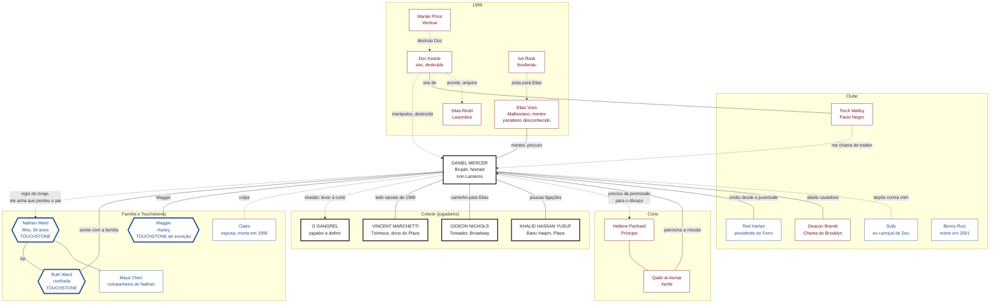

#jogador #auld-sanguine #daniel #readme

# Daniel "Danny" Mercer: o que você sabe

> Nova York · Dezembro de 2021
> Este arquivo é **só seu**. Reúne o que Daniel sabe e as relações dele com os outros personagens, do ponto de vista dele. Não repasse aos outros jogadores.

## Sumário
- [[#Como ler este arquivo]]
- [[#Onde você está em 2021]]
- [[#Seu sire e seu mentor]]
- [[#Sua família e seus Touchstones]]
- [[#O clube: o Ferro e a Chama]]
- [[#A coterie: os outros jogadores]]
- [[#A corte e outros NPCs Kindred]]
- [[#Mapa de relacionamentos]]
- [[#Os segredos que você guarda]]
- [[#O que os outros sabem de você]]

---

## Como ler este arquivo

| Marca | Quem é |
|---|---|
| 🎭 **Jogador** | Personagem de outro jogador da mesa (a coterie). Quem os conduz decide o que eles fazem; você só controla o que Daniel sabe e faz. |
| 🩸 **NPC Kindred** | Vampiro conduzido pelo Narrador. |
| 👤 **NPC mortal** | Humano conduzido pelo Narrador. |
| 🕯️ **Touchstone** | Ligação humana que segura a sua Humanidade (de NPC mortal). |

Tudo aqui é o que **Daniel** sabe ou acredita. Pode haver coisas que ele ignora, e algumas crenças dele podem estar erradas.

---

## Onde você está em 2021

- **Brujah**, mecânico e motociclista, do **Iron Lanterns MC** (Ferro desde 1976, Chama desde 1993, patch **Nomad** desde 2000). Nasceu em 1958 no Brooklyn e aparenta 35 anos; tem 63 de idade real e cerca de 28 de existência vampírica.
- Você foi **Abraçado em 1993** por **Donovan "Doc" Keane**, com câncer terminal e um filho de seis anos.
- Em **1999** você foi usado por Doc na **Segunda Guarda**: uma suposta reserva da Camarilla que era um golpe. Claire morreu, você foi preso, **testemunhou contra o seu próprio sire** e foi salvo no julgamento por **Elias Voss**.
- Desde 2000 você roda como **nômade** pela Costa Leste, serve à Camarilla e protege o filho à distância.
- **Agora você está de volta a Nova York.** Duas missões:
  - **A declarada:** levar um **Gangrel recém-Abraçado** à corte, por ordem da rede do Xerife **Qadir al-Asmai**. *"Localize-o. Traga-o a Nova York para apresentação e avaliação de ingresso. Com a cooperação dele, se puder. Sem ela, se precisar. Vivo."*
  - **A que não entra no relatório:** achar **Elias**, contar como a doença de Nathan avançou e perguntar o que ele sabe sobre salvá-lo.
- Quando passa por Nova York, você **não entra em Staten Island**.

---

## Seu sire e seu mentor

| Quem | O que você sabe |
|---|---|
| 🩸 **Doc Keane** (destruído em 1999) | Seu sire, cofundador do clube, o Lanterneiro. Deu-lhe 28 anos a mais e cobrou esses anos da sua família. Manipulou você, vazou o arquivo com as famílias da Chama ao Sabbat e causou a morte de Claire. Você não quer imitá-lo. Ele foi destruído por uma força da Camarilla comandada por Marian Price, depois do seu depoimento. |
| 🩸 **Elias Voss**, "O Cartógrafo" | Malkaviano, nascido em 1813 e Abraçado em 1871. Seu mentor e padrinho desde o julgamento. Salvou-o, protegeu Nathan com favores e intermediários e queimou as fichas da Chama na sua frente. É difícil de achar: alterna esconderijos. **Em 2021 ninguém de confiança sabe onde ele está.** Última conversa: em 2020, por telefone, quando ele disse: *"Se você decidir por ele, vai fazer com seu filho o que o Doc fez com você."* |

Pistas para achar Elias: uma oficina onde já o encontrou, um livreiro que recebeu um mapa dele e **Ivo Rask**, com ligações na rede Nosferatu.

---

## Sua família e seus Touchstones

| Pessoa | Quem é | O que você sabe |
|---|---|---|
| 🕯️ **Nathan Ward** (👤 NPC mortal) | Seu filho, nascido em 1987 (34 anos). Mora em **Queens**. | Usa o sobrenome **Ward** desde a proteção de Elias. Em **2020** recebeu o diagnóstico de uma **doença neuromuscular degenerativa e fatal**. Acredita ter perdido o pai em 1999. Ligado à Convicção *"Nunca use a família de alguém como arma."* |
| 🕯️ **Ruth Ward** (👤 NPC mortal) | Cunhada, irmã de Claire; 57 anos. Criou Nathan. | Sabe que você sobreviveu. É a sua ponte com a família: você recebe notícias por ela, não por informação paga. Ligada à Convicção *"Dê a quem você protege a chance de escolher."* |
| 🕯️ **Maggie** | Harley-Davidson azul-escura, comprada em 1979. | Batizada por Claire em 1985, com a cicatriz de metal no tanque deixada em Red Hook. Ligada à Convicção *"Ninguém da família fica para trás."* |
| 👤 **Maya Chen** | Companheira de Nathan. | Não sabe de nada. |
| 👤 **Claire Ward Mercer** (morta em 1999) | Sua esposa. | Não é Touchstone. Lembrança e culpa. Você guarda o relógio dela e o desenho de Nathan (os três numa Maggie "do tamanho de uma casa"). |

---

## O clube: o Ferro e a Chama

- **O Ferro:** membros mortais do clube, quase todos sem saber do sobrenatural. **A Chama:** vampiros, carniçais e poucos mortais escolhidos, os que conhecem o segredo. Lema: *"Ninguém volta para casa no escuro."*
- Depois de 1999, o clube se partiu em dois. As facções evitam guerra aberta desde 2001, mais por cansaço e pela Máscara do que por paz.

| | Iron Lanterns MC (Brooklyn) | Pavio Negro MC (Staten Island) |
|---|---|---|
| Alinhamento | Tolerada pela Camarilla; presta serviços à corte | Ligada aos Anarquistas |
| Líder da Chama | **Deacon Brandt** | **Torch Malloy** |
| Líder do Ferro | **Red Harlan** | Presidente leal a Torch |
| Posição sobre você | Irmão; alguns o veem como quem salvou o Brooklyn, outros como quem trouxe a guerra | Traidor; o seu nome não é dito na sede |

| Quem | O que você sabe |
|---|---|
| 👤 **Samuel "Red" Harlan** | Seu amigo desde a juventude, presidente do Ferro desde 2003, 66 anos. Sabe o que você é e guarda o segredo. Levou o seu pedido a Doc em 1993 e nunca se perdoou. Em 2021 deixou um recado: *"O Pavio está perguntando por você."* |
| 🩸 **Deacon Brandt** | Brujah, lidera a Chama do Brooklyn. Aliado cauteloso que cobra favores com precisão de tesoureiro. Você aprendeu com ele a contar favores. |
| 🩸 **Teresa "Torch" Malloy** | Brujah, prole de Doc, lidera o Pavio Negro. Considera você o traidor de Doc. Recado dela, semanas depois da morte de Doc: *"Ele te deu vinte anos a mais. Você deu ele para os Ventrue."* Nega até hoje que o arquivo tenha saído das mãos de Doc. |
| 👤 **Sully** | Ex-carniçal de Doc. Depôs no julgamento para preservar a vida; a Chama nunca o perdoou. Vivo e escondido. |
| 👤 **Benny Ruiz** | Irmão do Ferro que você viu crescer; morreu em 2001 na briga entre as facções, sem saber do segredo. |

Você carrega três mortes: **Claire**, **Doc** (que você não matou, mas entregou) e **Benny**.

---

## A coterie: os outros jogadores

Os sete 🎭 são **jogadores**. Os laços entre vocês são cinzentos: ninguém é melhor amigo de ninguém. **Nina, Gusman e Herta**, você ainda não conhece.

### 🎭 (Rafael) Jesse, o Gangrel
- Abraçado há pouco mais de um ano. Você foi enviado para levá-lo à corte; ser levado à cidade **não o torna Camarilla**, e a coerção do transporte não produz lealdade.
- A ordem é trazê-lo **idealmente vivo** e **sem alarde**, se possível.
- A ordem só chegou a você no **fim de novembro**: a Camarilla levou mais de um ano para rastreá-lo. No começo de dezembro você o achou **perdido na I-80, perto de Youngstown**, e o trouxe para Nova York: uns 640 km, duas noites de estrada. Além do nome, **ele não lhe contou nada sobre si**: de onde vem, quem era antes do Abraço ou o que fez.
- Ele é um espelho incômodo: um vampiro experiente chegando para dizer a alguém assustado o que fazer. Você conhece bem a voz que diz *"confie em mim, eu sei o que é melhor para você"*. Era a de Doc.

### 🎭 (Pedro) Vincent Marchetti, o dono do Plaza
- **Tzimisce**, **ex-Sabbat**, dono do **Hotel Plaza** e **herói de guerra** da Camarilla pela Batalha de 1999.
- Vincent está do **lado oposto** da mesma conquista: deu à Camarilla o plano que derrubou o Sabbat, enquanto você foi usado por um sire que tentou lucrar com a mesma guerra.

### 🎭 (Polck) Gideon Nicols, o produtor
- **Toreador**, produtor da **Broadway**, sem cargo mas com muito poder em favores e informação. Participou da Batalha de 1999 nos bastidores.
- Você o vê como **o caminho para Elias Voss**: ele conhece o Cartógrafo há décadas e circula entre pessoas que falam com ele. Se alguém sabe por onde começar a procurar, é Gideon. Ele não faz favores de graça, e você terá de decidir quanto contar para pedir esse.

### 🎭 (Klaus) Khalid Hassan Yusuf, o consultor de segurança
- **Banu Haqim**, mora no **Plaza** e trabalha como consultor de segurança do hotel. Vocês têm poucas ligações diretas além da coterie: ele não é próximo de você.

### 🎭 (Marcelle) Nina Calloway
- **Você não a conhece** e nunca ouviu o nome dela.

### 🎭 (Oliveira) Gusman Gutierrez
- **Você não o conhece** e nunca ouviu o nome dele.

### 🎭 (Rebeca) Herta Müller
- **Você não a conhece** e nunca ouviu o nome dela.

---

## A corte e outros NPCs Kindred

Todos 🩸 **NPCs Kindred**, salvo indicação.

| Quem | Papel | O que você sabe |
|---|---|---|
| **Hellene Panhard** | **Príncipe** de Nova York (Ventrue). | Só ela, ou alguém com autoridade delegada por ela, pode autorizar um **novo Abraço** em Nova York. Cumprir bem a missão do Gangrel pode abrir acesso à corte, mas não garante permissão. |
| **Qadir al-Asmai** | **Xerife** (Toreador). | A rede dele patrocina a sua missão. |
| **Marian Price** | Ventrue, oficial de campo em 1999. | Comandou a força que destruiu Doc. Pode ser quem nunca esqueceu o seu interrogatório. |
| **Ivo Rask** | Nosferatu. | Guardou as provas que exoneraram você. Pista para Elias. |
| **Calebros** | Nosferatu, ex-Príncipe provisório. | Ajudou a sustentar a credibilidade das verificações no julgamento. |
| **Silas Redd** | Intermediário Lasombra do Sabbat. | Doc fez um acordo com ele. Destino desconhecido desde 1999; possível portador de uma cópia do arquivo. |

---

## Mapa de relacionamentos

Visto de **Daniel**. Convenções: preto = jogador (🎭); vermelho = NPC Kindred (🩸); azul = NPC mortal (👤); azul com borda grossa = Touchstone (🕯️). Linha cheia = você sabe e é recíproco; linha tracejada = você sabe e o outro **não sabe**, ou é uma ligação distante.

---

## Os segredos que você guarda

- **O Abraço como opção.** Você já considera transformar Nathan e ainda não contou isso a ninguém. A permissão para um novo Abraço vem da Príncipe, e Nathan precisa poder decidir se quer essa existência: são duas decisões diferentes.
- **A vigilância sobre Nathan.** Você assistiu de longe à formatura e à cerimônia dele. Nathan não sabe que o pai está vivo e que o observou.
- **Os irmãos do Ferro nas caminhonetes.** No julgamento você se calou sobre quem dirigiu as cargas. Se vier à tona, eles estão expostos.
- **O que Doc foi.** Você carrega a prova de que o sire o manipulou e entregou as famílias da Chama, mas isso não prova nada contra o movimento anarquista inteiro.
- **Gostou da primeira caça.** Doc sabia que você ia gostar. Você nunca esqueceu.
- **A segunda razão de estar em Nova York.** O relatório fala do Gangrel; a verdade é Elias e Nathan.

---

## O que os outros sabem de você

- Na corte, o seu nome é ligado a um **julgamento de 1999**: você serviu à operação sem conhecer o objetivo político e foi liberado sob supervisão. **A desconfiança de alguns permanece.**
- Você acredita que ninguém da coterie sabe de **Nathan**, de **Ruth** ou da sua busca por **Elias**.
- A coterie (Gideon, Vincent e Khalid) sabe que você é Brujah, nômade do Iron Lanterns e veterano de 1999.
- **Nina**, **Gusman** e **Herta** não conhecem você.
