#jogador #auld-sanguine #gideon #readme

# Gideon Nicols: o que você sabe

> Auld Sanguine · Nova York · Dezembro de 2021
> Este arquivo é **só seu**. Reúne o que Gideon sabe e as relações dele com os outros personagens, do ponto de vista dele. Não repasse aos outros jogadores.

## Sumário
- [[#Como ler este arquivo]]
- [[#Onde você está em 2021]]
- [[#Sua senhora e seu clã]]
- [[#Quem você ama à distância (Mary)]]
- [[#Elias Voss, o Cartógrafo]]
- [[#A coterie: os outros jogadores]]
- [[#A corte e outros NPCs Kindred]]
- [[#Mapa de relacionamentos]]
- [[#Os segredos que você guarda]]
- [[#O que os outros sabem de você]]

## Como ler este arquivo

| Marca | Quem é |
|---|---|
| 🎭 **Jogador** | Personagem de outro jogador da mesa (a coterie). Quem os conduz decide o que eles fazem; você só controla o que Gideon sabe e faz. |
| 🩸 **NPC Kindred** | Vampiro conduzido pelo Narrador. |
| 👤 **NPC mortal** | Humano conduzido pelo Narrador. |
| 🕯️ **Touchstone** | Ligação humana que segura a sua Humanidade (de NPC mortal). |

Tudo aqui é o que **Gideon** sabe ou acredita. Pode haver coisas que ele ignora, e algumas crenças dele podem estar erradas.

---

## Onde você está em 2021

- **Toreador**, produtor teatral da **Broadway**, Abraçado em **1943**, durante os preparativos de *Oklahoma!*. São cerca de 78 anos de existência vampírica.
- Você **não tem cargo** na corte de Nova York. Seu poder está em **informação, favores e segredos** acumulados ao longo de quase um século, e você o usa para defender os interesses do clã Toreador nos bastidores.
- Sua especialidade é **Auspex** e a espionagem. Você usa a Broadway como fachada para identificar vítimas, fazer contatos e reunir informação sobre recursos, aliados e esconderijos do Sabbat e movimentos dos Anarquistas.
- Na **Batalha de Nova York (1999)**, mapeou refúgios e movimentos do Sabbat. Isso lhe rendeu **reconhecimento entre alguns anciões** da Camarilla, mas nenhum título.
- Seus **espetáculos e festas** têm no **Hotel Plaza** um endereço natural. Por isso você conhece a Broadway por dentro e o Plaza por dentro.

## Sua senhora e seu clã

| Quem | O que você sabe |
|---|---|
| 🩸 **Cordelia Vane** (sua senhora, atriz Toreador; **desaparecida desde 2008**) | Estrela da Broadway que nunca envelhecia no palco: a cada geração de plateia ela era "uma nova atriz". Em 1943 você recusou a participação de uma atriz que, sem você saber, era Toreador: a própria Cordelia. Ofendida, ela o Abraçou como castigo. A Camarilla também queria consolidar influência em Nova York, e suas conexões no meio artístico eram valiosas. Ela nunca o viu como protegido: viu como **ferramenta**. A relação era instrumental até o fim. |
| 🩸 **O sumiço de Cordelia** | No início de 2008, na onda da **Segunda Inquisição**, uma operação federal disfarçada de **prisão por fraude** levou Cordelia de madrugada. O refúgio dela, no Upper West Side, foi encontrado vazio e lacrado. A imprensa noticiou que ela "se retirou da vida pública". **Você não sabe se ela foi destruída ao amanhecer ou se está numa instalação**, e a Camarilla a contou como mais um número nas baixas. Cordelia conhecia o seu rosto, a sua rede e os seus endereços, e você nunca soube o que ela disse, se é que disse. Como você sentiu isso é decisão sua. |
| 🩸 **Clã Toreador** | Você defende os interesses do clã de forma discreta, sem cargo. Sem a sua senhora, não há ninguém acima de você no clã a quem prestar contas. |

---

### Sem sire, sem Primogen: a quem você responde

- Na estrutura da corte, quem representa o clã perante o Príncipe é o **Primogen**, e um Kindred sem sire responde politicamente a ele.
- **Em 2021, o clã Toreador de Nova York não tem Primogen.**
- As maiores autoridades Toreador da Camarilla na cidade são duas, e ambas têm outro cargo:
  - **Thomas Arturo**, **Herald** (Harpia) da corte.
  - **Qadir al-Asmai**, **Xerife**.
- **Em teoria, a sua responsabilidade política recai sobre esses dois.** Na prática, você **não reporta diretamente a ninguém** e não precisa de fato de um senhor.
- Você tem **78 anos de existência vampírica**, a poucas décadas de completar um século, e é o Membro da coterie mais antigos na cidade. A sua contribuição na **Batalha de Nova York** reforça isso: você tem **liberdade e bastante independência**.

## Quem você ama à distância (Mary)

Mary e pessoas relacionadas.

| Pessoa | Quem é | O que você sabe |
| --- | --- | --- |
| 👤 **A jornalista**  (Mary Winchester) | A jovem repórter que você conheceu nos anos 2000. A curiosidade e a independência dela o fizeram reconsiderar convicções antigas. | Você se afastou quando o envelhecimento dela e a sua juventude imutável ficaram impossíveis de ignorar, por medo de ser descoberto. Hoje ela **chefia o *The Harbor Ledger***, redação de jornalismo investigativo local em Lower Manhattan, que cobre habitação, polícia, contratos públicos e o porto. Você acompanha a carreira dela à distância, com contatos esporádicos. |
| 👤 **Leila Yusuf** | Repórter investigativa que **trabalha no *The Harbor Ledger***, sob a sua jornalista. | Você sabe que Leila é **irmã de Khalid**. Khalid não faz ideia de que alguém que você ama trabalha ao lado da irmã dele. |

---

## Elias Voss, o Cartógrafo

🩸 **NPC Kindred.** Malkaviano. Você sabe mais sobre ele do que qualquer outro membro da coterie.

- Abraçado em **1871**, tem cerca de 150 anos de existência. É muito mais antigo e influente que a maioria da corte, sem ser Matusalém nem resolver qualquer problema sozinho. **Não ocupa cargo**: é um conselheiro tolerado e requisitado por quem nem sempre gosta dele. O prestígio vem de informação, favores e intervenções que deram certo.
- Parece um senhor de quase sessenta anos, de sobretudo gasto, com a mania de **traçar rotas nas bordas de documentos**. Confunde uma estação demolida com uma que ainda existe, e às vezes percebe uma intenção hostil antes que ela se manifeste. Você aprendeu a anotar o que ele diz e procurar algo verificável. Nem tudo é profecia, nem ele é caricatura.
- Você o conhece **há décadas** e já falou com ele algumas vezes, quase sempre **por intermediários**. Ele raramente aparece em salões da corte.
- Você sabe que ele **salvou Daniel no julgamento de 1999**. Não sabe mais do vínculo entre os dois.
- **Hoje ninguém de confiança sabe onde ele está.** Elias alterna esconderijos e intermediários e às vezes passa meses sem contato. Não é novidade, mas é a primeira vez que alguém na coterie precisa dele com urgência.

#### Por onde você começaria a procurá-lo
Você não sabe onde ele está, mas sabe **quem procurar primeiro**. São contatos seus de décadas de bastidores, e nenhum deles sabe o paradeiro atual:

| Quem | Papel | O que você sabe |
|---|---|---|
| 👤 **Walter "Wally" Drake** | Contrarregra de um pequeno teatro no West Village. | Elias deixa envelopes "para o Cartógrafo" no almoxarifado do teatro, e Wally os entrega a quem aparecer com a senha. Você pagou o conserto do telhado do teatro anos atrás: ele lhe deve. |
| 👤 **Odile Marchand** | Dona de um antiquário de cartazes e programas antigos perto da Times Square. | Recebe de Elias programas com as margens anotadas e os revende a colecionadores. Sabe a quem. Vende caro e conta pouco. |
| 🩸 **Lucinda "Lu" Hargrove** | Malkaviana neonata, atriz de teatro experimental. | Frequenta seus ensaios e já foi mensageira de Elias. Diz o que ouviu, mas nem sempre na ordem em que ouviu. |

- **Daniel o vê como o caminho para Elias.** Se ele pedir ajuda, é você quem sabe por onde começar, e isso tem preço: um favor, uma informação, ou o que Daniel carrega.
- Você decide quanto contar, a quem e por quê.

---
## A coterie: os outros jogadores

Os quatro 🎭 são **jogadores**. Os laços entre vocês são cinzentos: ninguém é melhor amigo de ninguém, mas todos têm história com todos. (Gusman é o único que **você** trouxe para dentro.)

### 🎭 Vincent Marchetti, o dono do Plaza
- **Tzimisce**, **ex-Sabbat**, dono do **Hotel Plaza**. **Herói de guerra** da Camarilla pela Batalha de 1999.
- Vocês se **conheceram e se ajudaram na Batalha de Nova York**: informação de refúgios de um lado, a lista do outro.
- **Você avaliou Vincent em 1999 e o recomendou à Camarilla.** Isso cria uma **dívida relativa**: ele deve a você ter sido aceito, mas você também se beneficiou do que ele entregou.
- Vocês **se encontram regularmente**, e o Plaza é palco natural das suas festas.
- **Gusman:** Vincent é o **terceiro do segredo**. Você e Khalid o chamaram por ser ex-Sabbat, e ele deu **cobertura** a Gusman nas primeiras semanas. Ele **não sabe o nome verdadeiro** de Gusman. Ver [[#🎭 Gusman Gutierrez, o seu protegido]].
- 🔒 **Você não viu nada estranho em Vincent em 1999.** Com os anos, passou a ter uma **sensação**, sem certeza nenhuma, de que o segredo dele tem relação com **diablerie**. Você guarda isso para si. Vincent não sabe que você desconfia.

### 🎭 Daniel Mercer, o nômade
- **Brujah**, ligado ao motoclube **Iron Lanterns**, esteve na guerra de 1999.
- Você **sabe quem Daniel é na Camarilla**: o homem que testemunhou contra o próprio sire e foi salvo no julgamento por **Elias Voss**.
- **O que você sabe do desvio de tropas** (fatos que circulam entre quem importa):
  - Durante a Batalha, um grupo de Brujah do clube de Daniel, liderado pelo sire dele, **Donovan "Doc" Keane**, se apresentou como uma "reserva" da Camarilla (a **Segunda Guarda**) e **desviou veículos, armas e rotas de evacuação** para uma equipe própria. Eles tomaram um **depósito em Red Hook**.
  - Daniel **trabalhou para essa reserva**: levou mensagens e cargas. Na **terceira noite** foi preso dirigindo uma caminhonete de armas para o depósito, com ordens falsas no bolso do colete. A acusação foi desvio de material de guerra e colaboração com a mobilização anarquista.
  - No **julgamento**, numa instalação de campanha e diante de poucas pessoas, **Elias Voss** exigiu que o caso fosse examinado antes de uma execução sumária. As provas guardadas por **Ivo Rask** mostraram que as ordens eram falsificadas e que Daniel não conhecia o objetivo político. Ele foi **liberado sob supervisão**: *"Ele não sabia. Agora sabe. Julguem o que ele fizer a partir daqui."*
  - O depoimento de Daniel **apontou os abrigos da Segunda Guarda**. Na noite seguinte, uma força da Camarilla comandada por **Marian Price** cercou Red Hook e **destruiu Doc**.
- **O que você infere** (ninguém confirmou): para cercar Red Hook, os comandantes tiraram gente do cerco do **Bronx** justamente na noite em que o arcebispo **Polonia** tentava fugir. Seus informantes viram o cordão afinar e a rota de fuga ficar aberta. Daniel não escolheu isso e não sabia o que estava ajudando, mas **o desvio de tropas que deixou Polonia escapar começa na história dele**.
- Essa é uma informação que vale mais calada do que dita. Você não conhece os detalhes pessoais de Daniel nem o que Doc fez com a família dele.
- **Daniel não sabe de Gusman** e fica de fora do segredo.

### 🎭 Khalid Hassan Yusuf, o consultor de segurança
- **Banu Haqim**, mora no **Plaza** há cerca de dez anos e trabalha como **consultor de segurança do hotel**.
- Você sabe que a **Primogen dos Banu Haqim, Samira**, foi a **ponte** que o levou à corte. Você tem **certeza de que ela não é a sire dele**.
- Khalid nunca disse quem é o sire. Você **suspeita de alguém do alto escalão**, mas não sabe o quanto.
- Você sabe da irmã dele, Leila, que trabalha no *The Harbor Ledger* (ver [[#Quem você ama à distância (Mary)]]). Khalid não sabe que você sabe.
- **Gusman:** foi Khalid quem vigiou o domínio para você e quem achou, junto com você, o rapaz do metrô. Depois, **foi Khalid quem descobriu o nome verdadeiro dele**. Ver [[#🎭 Gusman Gutierrez, o seu protegido]].

### 🎭 Gusman Gutierrez, o seu protegido
- **Ravnos** de 13ª geração, Abraçado em 2018, **sem sire conhecido**. **Você é o responsável por ele.** Ele mora em **Staten Island**. 🔒 **Ele não sabe que é Ravnos.**
- **Como vocês o acharam:** você procurava um **Ravnos sobrevivente da Semana de Pesadelos** que teria entrado no domínio, para entender o que aconteceu e juntar **informação e capital político** para a Camarilla. Khalid vigiava quem entrava e saía. Em **março de 2018** acharam um rapaz **recém-Abraçado**, acordando numa **estação do metrô** da 50th Street, **com uma marca escrita no peito** (sânscrito misturado com a marca de Caim, com ar de Sabbat). Um policial do metrô chegou a ver o corpo "morto".
- **A gravação:** Khalid achou uma **figura encapuzada** que escreve a marca, **vira para a câmera sem mostrar o rosto**, dá um **meio sorriso**, e a **câmera corta**. Ninguém decifrou a marca nem sabe quem é a figura.
- **O segredo:** você argumentou que não era sábio expor Gusman à Camarilla sem provas, para **não causar alarde** e porque **informação vale ouro**. Contaram a **Vincent**, que é ex-Sabbat e **sabe que Gusman é Ravnos**. Os três guardam o segredo. Vincent deu **cobertura** nas primeiras semanas.
- **Ele sabe quase nada da sociedade vampírica.** Você e Khalid ensinaram o básico (Fome, alimentação, Máscara, sol). Ele **evita outros Kindred**.
- **O que você lhe disse:** que, sem sire e sem clã reconhecível, ele é **provavelmente um Caitiff** (Khalid e Vincent concordaram). **Nem ele sabe que é Ravnos.** Se perguntarem, ele diz **com sinceridade** que não sabe de que "tipo de vampiro" é. **Ninguém de fora sabe que é Ravnos.** Pode ser que algum Kindred já o tenha visto na rua, mas você não sabe de nenhum.
- **A alimentação:** primeiro, bolsas de sangue desviadas por vocês. Depois, o enfermeiro **Marcus Bell**, que você conheceu por **Tessa Lang**, uma das suas artistas, que o namora. Hoje Gusman se vira sozinho.
- 🔒 **O nome verdadeiro:** Khalid investigou a origem dele (orfanato, amigos) e lhe entregou o nome, **Julian Jiménez**. Você tem **uma vaga impressão** de que o nome verdadeiro de um Ravnos, **em alguns casos**, dá **mais controle** sobre ele. Quando você o usa, **sente Gusman ceder** e aceitar o que você diz. Você usa pouco. **Nem Khalid nem Vincent** sabem disso. **Gusman não sabe por que cede.**
- **Daniel não sabe** que Gusman existe.
- ⚠️ **O risco é seu.** Esconder um Abraço fere a **Terceira Tradição (Progeny)**. Se o **Xerife Qadir** ou o **Príncipe Panhard** descobrirem, **você é o responsável**. E se **Gusman** descobrir que você lhe escondeu o clã, é a confiança dele que quebra.

---
## A corte e outros NPCs Kindred

Todos 🩸 **NPCs Kindred**.

| Quem | Papel | O que você sabe |
|---|---|---|
| **Cordelia Vane** | Sua senhora, Toreador. | Desaparecida desde 2008. Ver [[#Sua senhora e seu clã]]. |
| **Elias Voss** | Malkaviano, conselheiro tolerado, "O Cartógrafo". | Ver [[#Elias Voss, o Cartógrafo]]. Paradeiro atual desconhecido. |
| **Thomas Arturo** | **Herald** da corte (Toreador). | Maior autoridade do seu clã na cidade, junto com Qadir. Em teoria, responde politicamente por você. Ver [[#Sem sire, sem Primogen: a quem você responde]]. |
| **Qadir al-Asmai** | **Xerife** de Nova York (Toreador). | Idem. |
| **Samira** | **Primogen dos Banu Haqim** em Nova York. | Foi a ponte entre Khalid e a corte. Não é a sire dele. |
| **Hellene Panhard** | **Príncipe** de Nova York (Ventrue). | Autoridade da Camarilla na cidade. |
| **Marian Price** | Ventrue, oficial de campo em 1999. | Comandou a força que destruiu Doc Keane em Red Hook. |
| **Anciões da Camarilla** | Quem lhe deve reconhecimento pela Batalha de 1999. | Sem cargo, só **favores**. |

---

## Mapa de relacionamentos

Visto de **Gideon**. Convenções: preto = jogador (🎭); vermelho = NPC Kindred (🩸); azul = NPC mortal (👤). Linha cheia = você sabe e é recíproco; linha tracejada = você sabe e o outro **não sabe**, ou é uma ligação distante.

```mermaid
flowchart TB
  G["GIDEON NICHOLS<br/>Toreador, Broadway<br/>sem cargo"]:::pc
  subgraph ORI["Origem"]
    Sen["Cordelia Vane<br/>sua senhora<br/>sumiu em 2008"]:::kindred
    Inq["Segunda Inquisição"]:::local
    Anc["Anciões<br/>reconhecimento de 1999"]:::kindred
  end
  subgraph MOR["Quem você ama à distância"]
    Rep["Mary Winchester<br/>chefe do veículo"]:::mortal
    Leila["Leila Yusuf<br/>irmã de Khalid"]:::mortal
  end
  subgraph ELI["Elias Voss e seus intermediários"]
    Elias["Elias Voss<br/>Malkaviano, o Cartógrafo<br/>paradeiro desconhecido"]:::kindred
    Wally["Wally Drake<br/>contrarregra"]:::mortal
    Odile["Odile Marchand<br/>antiquária"]:::mortal
    Lu["Lu Hargrove<br/>Malkaviana neonata"]:::kindred
  end
  subgraph COT["Coterie (jogadores)"]
    V["VINCENT MARCHETTI<br/>Tzimisce, dono do Plaza"]:::pc
    D["DANIEL MERCER<br/>Brujah, Iron Lanterns"]:::pc
    K["KHALID HASSAN YUSUF<br/>Banu Haqim, Plaza"]:::pc
  end
  subgraph TOR["Clã Toreador na corte"]
    Prim["Primogen Toreador<br/>não existe em 2021"]:::vazio
    Arturo["Thomas Arturo<br/>Herald"]:::kindred
    Qadir["Qadir al-Asmai<br/>Xerife"]:::kindred
  end
  subgraph COR["Corte (NPCs Kindred)"]
    Samira["Samira<br/>Primogen Banu Haqim"]:::kindred
    Panhard["Hellene Panhard<br/>Príncipe"]:::kindred
  end
  G -. "me usou como ferramenta" .- Sen
  Inq -. "levou, destino ignorado" .-> Sen
  G -- "favores" --- Anc
  G -. "observo de longe,<br/>contatos esporádicos" .-> Rep
  Rep -- "chefe de" --- Leila
  G -- "conheço há décadas,<br/>sempre por intermediários" --- Elias
  Wally -. "envelopes" .-> Elias
  Odile -. "programas anotados" .-> Elias
  Lu -. "mensageira" .-> Elias
  G -- "devem favores" --- Wally
  G -- "contato" --- Odile
  G -- "frequenta meus ensaios" --- Lu
  Elias -. "salvou no julgamento de 1999" .-> D
  G -- "recomendei, dívida<br/>nos encontramos" --- V
  G -. "sensação de diablerie.<br/>Ele não sabe que desconfio" .-> V
  G -- "sei quem é,<br/>sei do desvio de tropas" --- D
  D -. "me vê como caminho<br/>até Elias" .-> G
  G -- "festas no Plaza" --- K
  G -. "sei que Leila é irmã dele.<br/>Ele não sabe que sei" .-> K
  Leila -. "irmã de" .- K
  G -. "suspeito do sire.<br/>alto escalão" .-> K
  Samira -. "ponte, não é a sire" .-> K
  G -. "responsabilidade política<br/>em teoria" .-> Arturo
  G -. "responsabilidade política<br/>em teoria" .-> Qadir
  Prim -. "vago" .- G
  Panhard --- Qadir
  Qadir --- Arturo
  classDef pc fill:#ffffff,stroke:#231f20,color:#231f20,stroke-width:3px
  classDef kindred fill:#ffffff,stroke:#790914,color:#790914
  classDef mortal fill:#ffffff,stroke:#1f4e8c,color:#1f4e8c
  classDef local fill:#ffffff,stroke:#231f20,color:#231f20,stroke-dasharray: 4 3
  classDef vazio fill:#ffffff,stroke:#790914,color:#790914,stroke-dasharray: 4 3
```

---

## Os segredos que você guarda

- **A sensação sobre Vincent.** Você desconfia de diablerie e guarda isso para si. É uma carta que você nunca usou.
- **A ligação entre Leila e Mary Winchester.** Você sabe que a irmã de Khalid trabalha na redação de quem você ama, e Khalid não sabe.
- **A suspeita sobre o sire de Khalid.** Alguém do alto escalão, sem saber o quanto.
- **O que Cordelia sabia.** O seu rosto, a sua rede e os seus endereços foram parar nas mãos da Segunda Inquisição ou desapareceram com ela. Você não sabe qual das duas.
- **A leitura do desvio de tropas.** Você liga a história de Daniel à fuga de Polonia, e isso você guarda.
- **A distância de Mary.** Você a protege ficando longe, e esse é o mesmo gesto que o isola.

- **Gusman é Ravnos, e foi achado por uma busca sua.** Você procurava um Ravnos e não contou isso a Gusman. **Nem ele sabe que é Ravnos**: você lhe disse que provavelmente é Caitiff. Quem de fora sabe o clã dele: ninguém.
- **O nome verdadeiro de Gusman e o que ele faz.** Você tem uma vaga impressão de que o nome dá controle sobre um Ravnos, e sente Gusman ceder quando o usa. Khalid e Vincent não sabem.
- **A explicação do Caitiff.** Foi ideia sua dizer isso a Gusman, e Khalid e Vincent a sustentaram. Se ela cair, a pergunta será por que você mentiu a quem você diz proteger.
- **O Abraço escondido.** Vocês três esconderam um Abraço da corte desde 2018. A Terceira Tradição recai sobre você.

## O que os outros sabem de você

- **Vincent** sabe que você o avaliou e o recomendou em 1999 e que vocês se encontram regularmente. Não sabe que você desconfia de nada.
- **Todos** sabem que você é Toreador, produtor da Broadway, que faz festas no Plaza e que tem fama de bem informado.
- **Quem acompanha a corte** sabe que a sua senhora, Cordelia Vane, desapareceu em 2008.
- **Ninguém** sabe de Mary Winchester nem da relação dela com a redação de Leila.
- **Khalid e Vincent** sabem de Gusman e do segredo, mas **não** sabem que o nome verdadeiro dele dá a você algum controle, nem que você o usa.
- **Gusman** sabe que você sabe o nome dele e que ele **cede** quando você o diz. Não sabe por quê, nem que você procurava um Ravnos.
- **Daniel e a corte** não sabem de Gusman.
