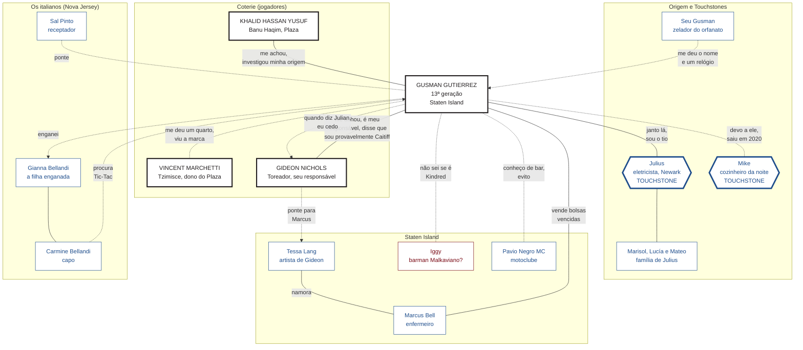

#jogador #auld-sanguine #gusman #readme

# Gusman Gutierrez: o que você sabe

> Nova York · Dezembro de 2021
> Este arquivo é **só seu**. Reúne o que Gusman sabe e as relações dele com os outros personagens, do ponto de vista dele. Não repasse aos outros jogadores.

## Sumário
- [[#Como ler este arquivo]]
- [[#Onde você está em 2021]]
- [[#Quem você é: o nome, o orfanato e a plaquinha]]
- [[#Seus amigos e Touchstones]]
- [[#O ofício e os italianos]]
- [[#O que você é e o que aconteceu em 2018]]
- [[#A coterie: os outros jogadores]]
- [[#Staten Island e os conhecidos da noite]]
- [[#A corte]]
- [[#Mapa de relacionamentos]]
- [[#Os segredos que você guarda]]
- [[#O que os outros sabem de você]]

---

## Como ler este arquivo

| Marca | Quem é |
|---|---|
| 🎭 **Jogador** | Personagem de outro jogador da mesa (a coterie). Quem os conduz decide o que eles fazem; você só controla o que Gusman sabe e faz. |
| 🩸 **NPC Kindred** | Vampiro conduzido pelo Narrador. |
| 👤 **NPC mortal** | Humano conduzido pelo Narrador. |
| 🕯️ **Touchstone** | Ligação humana que segura a sua Humanidade (de NPC mortal). |

Tudo aqui é o que **Gusman** sabe ou acredita. Pode haver coisas que ele ignora, e algumas crenças dele podem estar erradas.

---

## Onde você está em 2021

- Você tem **24 anos** na ficha e aparenta **22**. Foi **Abraçado em março de 2018**, há quase quatro anos. É de **13ª geração**.
- Você mora em **Staten Island**, num **apartamento** sobre uma lavanderia 24h na **Port Richmond Avenue**, com uma bancada de relojoeiro. Fora de Manhattan, por conselho de Gideon.
- Você vive de **relógios falsificados** e de pequenos serviços. **Resources 1**: dá para pagar o básico.
- Você se alimenta de **bolsas de sangue vencidas**, compradas do enfermeiro **Marcus Bell**. É o que a ficha chama de **Iron Gullet**.
- Você **não sabe de que clã é**. Gideon, Khalid e Vincent lhe explicaram que, sem sire e sem linhagem, você é **provavelmente um Caitiff**. Quem pergunta ouve a verdade que você conhece: **não sei que "tipo de vampiro" eu sou**. Você **evita outros Kindred**.
- Sua **Ambição**: *ser um grande empresário*. Seu **Desejo**: *descobrir quem está me ameaçando*.
- Sua **Convicção**: *"Prezar pelas crianças. Cada uma carrega um futuro que ninguém sabe até onde pode ir."*

> 🔒 **Para o jogador:** a **sua ficha** diz **Ravnos**, e você, jogador, sabe. **Gusman não sabe.** Tudo neste arquivo que mexe com o clã (alho, ilusões, *Tempting Fate*, ceder ao nome) é, para ele, **esquisitice sua**. Interprete assim.

## Quem você é: o nome, o orfanato e a plaquinha

- Você nasceu em **1996** e foi deixado **bebê** na **Casa Santa Rita**, um orfanato de **Newark** que **fechou em 2016**. Nunca foi adotado.
- Havia **uma plaquinha** com o seu nome de nascimento: **Julian Jiménez**. É um pedaço de **latão cortado do fundo de uma caixa de relógio de pulso barato**, com o nome **gravado à mão, com punção**. No verso há uma marca de fabricante quase apagada e **"3·96"** riscado. Você a achou **aos 12 anos**, ao **arrombar a gaveta do diretor**.
- Para você, a plaquinha é a prova de que alguém lhe deu um nome, e de que você **escolheu outro**. Quem a fez teve pressa, usou **o próprio relógio** e sabia gravar metal. Você guarda a ideia de que **lhe deixaram o tempo de alguém**.
- Ela fica dentro da caixa de um **relógio de bolso quebrado**, presente do **zelador, seu Gusman**, na **gaveta falsa da bancada** do apartamento. Você pegou o nome dele para si. Foi o seu Gusman quem lhe deu o gosto por relógios.
- Aos **18 anos (2014)** você saiu do orfanato e se registrou como **Gusman Gutierrez**. Por isso o nome **Julian Jiménez é muito difícil de rastrear**: não há registro, endereço nem crédito nele.
- Você fala **espanhol**, que aprendeu no orfanato.

---

## Seus amigos e Touchstones

Cresceram com você no orfanato. **Nenhum dos dois sabe que você é vampiro.** Os dois sabem o seu nome verdadeiro.

| Pessoa | Quem é | O que você sabe |
|---|---|---|
| 🕯️ **Julius** (👤 NPC mortal) | Amigo de orfanato. **Homem de família.** Mora em **Newark**, é **eletricista de manutenção** num edifício comercial. | Casado com **Marisol**, pai de **Lucía (7)** e **Mateo (4)**. Você é "o tio" e janta lá de vez em quando. Ele **desconfia do que você faz da vida e não pergunta**. Em 2018 ele **visitava Mike** e foi quem passou as suas cartas. As crianças dele são o motivo concreto da sua Convicção. |
| 🕯️ **Mike** (👤 NPC mortal) | Amigo de orfanato. Foi seu **parceiro no começo do crime**. | **Preso em 2016** numa entrega que deu errado, **assumiu a culpa sozinho** e **não entregou você**. **Só saiu em 2020.** Você foi Abraçado com ele ainda preso e **não pôde visitá-lo**; **mandou cartas** por Julius, sem explicar. Hoje ele é **cozinheiro de turno da noite** num diner, mora sozinho e **nunca cobrou nada**. **Você deve a ele**, e o golpe de 2017 foi em parte por ele. |
| 👤 **Seu Gusman** (NPC mortal) | **Zelador** do orfanato. | Foi quem lhe deu o nome que você usa e o relógio de bolso. Você não sabe se ele está vivo. |

---

## O ofício e os italianos

- Depois de sair do orfanato, você entrou no **crime miúdo**: **entregas de ilícitos**, **identidades forjadas**, **arrombamentos** (você sabe abrir fechaduras). **Você nunca foi violento.**
- Por paixão, passou a **falsificar relógios e vendê-los na rua**. Hoje a bancada continua no apartamento, o **estoque** fica num **box de self-storage 24h em Mariners Harbor**, pago em dinheiro no nome **Gusman Gutierrez**, e a venda é **on-line** (entrega à noite em estações da Staten Island Railway) e no bar de Iggy. Você evita **Manhattan e Nova Jersey**.

**O golpe do Submariner (outono de 2017)**
- Em 2017 você precisava de dinheiro para pagar um **advogado para a apelação de Mike**. **Gianna Bellandi**, filha do capo **Carmine "Carm" Bellandi** (uma equipe de Nova Jersey, com fachada numa joalheria em Belleville), pediu por você, por meio do receptador **Sal Pinto**, um **Rolex Submariner de 1966** para os 60 anos do pai.
- Você montou um relógio falso com **papéis forjados** e vendeu a ela por **dezenas de milhares de dólares**. Ela **tirou o dinheiro do caixa do pai**.
- Na **festa**, um **velho relojoeiro** amigo de Carmine **abriu o relógio e descobriu a fraude** diante da equipe inteira. Carmine foi humilhado e Gianna foi afastada dos livros. **Sal Pinto apanhou**.
- **A apelação de Mike não deu em nada.** Você perdeu nos dois lados.
- Os italianos sabem seu apelido de rua, **"Tic-Tac"**, e seu rosto (a câmera da joalheria). **Não sabem** seu nome, nem o orfanato, nem Mike e Julius, nem que você é vampiro. Você **sumiu da rua** e, **quatro meses depois**, foi Abraçado.
- 🔒 Staten Island tem **forte presença ítalo-americana**. Se alguém da equipe o vir, você **não envelheceu** desde 2017.

---

## O que você é e o que aconteceu em 2018

**Provavelmente um Caitiff.** Foi o que **Gideon** lhe disse, com **Khalid** e **Vincent** concordando: sem sire, sem clã que os outros reconheçam e sem linhagem, você deve ser **Caitiff**, um vampiro sem clã. Disseram que a corte **trata Caitiff com desprezo**, e que por isso o melhor é **ficar longe dela**. Você **não conhece** o nome **Ravnos** nem a **Semana de Pesadelos**.

**Suas esquisitices** (que você atribui a ser "um Caitiff estranho"): **Presence** e **Obfuscate**, que você usa como ferramenta; um **impulso de escolher a saída mais perigosa e ousada** (a *Tempting Fate*); e o **alho**, que o faz mal. Você acha que são coisas suas.

**A noite de março de 2018**
- Você **acordou numa estação do metrô** (a 50th Street, na linha 1), **no meio da noite**, **já Abraçado** e **sem lembrar de nada** do sire. **Você não sabe quem o fez.** Havia um **policial do metrô** por perto, que viu o seu corpo "morto" e depois você de pé, e **dois estranhos**: **Gideon e Khalid**.
- Eles o levaram para o **porão do teatro de Gideon** e lhe ensinaram o que significa ser vampiro: **Fome**, **como se alimentar**, **o sol**, **a Máscara**, **o que evitar**.

**A marca no peito**
- Você acordou com **uma marca escrita no peito**, feita com o seu próprio sangue: **letras devanágari** em torno de **um desenho angular** que lembra a **marca de Caim**. Virou uma **cicatriz pálida e elevada**. Você a **cobre sempre**.
- Gideon, Khalid e Vincent **não sabem lê-la** e **você também não**. Vincent disse que o **estilo lembra o Sabbat**, e isso não o deixa em paz.
- Você **não sabe** quem a escreveu.

**O seu nome verdadeiro e Gideon**
- Khalid foi atrás de **onde você veio**. Você sabe que ele chegou ao orfanato e aos seus amigos e que **sabe o seu nome verdadeiro**. Gideon também o sabe.
- 🔒 **Quando Gideon diz "Julian", você cede.** Fica parado e aceita o que ele pede. Aconteceu mais de uma vez, e **você não sabe por quê**. Vive isso como **uma fraqueza sua**. Você sabe que **Gideon sabe** que isso acontece.
- Você **não sabe** que isso vem da maldição do seu clã.

## A coterie: os outros jogadores

Os três 🎭 abaixo são **jogadores**. **Daniel Mercer** também é jogador, mas **você nunca ouviu falar dele**.

### 🎭 Gideon Nicols, o seu responsável
- **Toreador**, **produtor da Broadway**. Mora e trabalha em Manhattan, com muito poder em **favores e informação**.
- **Foi um dos dois que o acharam** e **ficou responsável por você**. Ensinou, alimentou nos primeiros meses e **mandou você se esconder da "corte"**, porque disse que seria perigoso se apresentar. Foi ele quem lhe **explicou que você é provavelmente um Caitiff**.
- Foi ele quem lhe arranjou o **enfermeiro Marcus Bell**, por meio de **Tessa Lang**.
- Ele **sabe seu nome verdadeiro** e você **cede** quando ele o diz. Você **não sabe** que ele procurava um Ravnos antes de achar você.
- Você **confia nele**, mas essa dívida pesa.

### 🎭 Khalid Hassan Yusuf, o investigador
- **Banu Haqim**, **segurança do Hotel Plaza**, onde mora.
- **Foi o outro dos dois que o acharam.** Cuidou das **câmeras** e dos **registros** para que o seu nome não aparecesse. Concordou com Gideon que você é **provavelmente Caitiff**.
- Ele **investigou a sua origem**: o **orfanato**, **Mike e Julius**, o **seu nome verdadeiro**. Você **não sabe até onde ele foi** nem se chegou a procurar os seus amigos.

### 🎭 Vincent Marchetti, o dono do Plaza
- **Tzimisce**, **dono do Hotel Plaza**. Gideon disse que ele foi do **Sabbat** e é **herói de guerra** da Camarilla. Você não sabe bem o que isso quer dizer.
- Nas primeiras semanas ele lhe deu **um quarto fora do registro do hotel**. Ele **viu a marca** e disse que o estilo lembra o Sabbat. Também concordou que você é **provavelmente Caitiff**. Ele **não sabe o seu nome verdadeiro**, até onde você sabe.

### 🎭 Daniel Mercer
- **Você não o conhece** e nunca ouviu o nome dele.

---

## Staten Island e os conhecidos da noite

| Quem | Papel | O que você sabe |
|---|---|---|
| 🩸 **Iggy** (Ignatius Pell) | Dono e barman do ***The Broken Minute***, na **Richmond Terrace** (Port Richmond). | O bar é decorado com **relógios quebrados** parados em horas diferentes; foi por isso que você apareceu lá. Iggy compra relógios quebrados de você. Ele o chama de **"Relojoeiro"** e já disse coisas como *"seu relógio parou numa estação"*. Você **nunca o viu comer ou beber**, mas também nunca viu nada que **só um vampiro** faria. **Você não sabe se ele é Kindred.** Nunca perguntou, e ele nunca disse. |
| 👤 **Marcus Bell** | **Enfermeiro** de um hospital da ilha. Seu Contato (••). | Vende a você **bolsas vencidas**. Você o conheceu por **Tessa Lang**. |
| 👤 **Tessa Lang** | **Artista** de Gideon (atriz de coro). | Namora Marcus. **Não sabe** que você é vampiro. |
| **Pavio Negro MC** | Motoclube que você **conhece de nome**. | Você esbarrou neles em **bares**, quando era mortal, em **contrabando miúdo**. **Não sabe** nada da história do clube. Ele **frequenta o *Broken Minute*** de vez em quando; você **vai em dias de semana** para evitá-los. |

> 🔒 Você não sabe que o Pavio Negro tem ligação com os Anarquistas da ilha. Para você, são **motoqueiros**.

---

## A corte

- Você **quase nada sabe** da sociedade vampírica. Sabe que existe **"a corte"** (a Camarilla) e que **Gideon disse que você deve ficar longe dela**, porque um Abraço escondido e um **Caitiff** sem apresentação são **motivo de problema**.
- Você **não sabe** como a Camarilla se organiza, nem o que são **Anarquistas** e **Sabbat**, nem quem manda em Nova York.
- Se um Kindred perguntar o que você é, você diz a verdade que conhece: **não sei**. Gideon disse que você é provavelmente Caitiff.

## Mapa de relacionamentos

Visto de **Gusman**. Convenções: preto = jogador (🎭); vermelho = NPC Kindred (🩸); azul = NPC mortal (👤); azul com borda grossa = Touchstone (🕯️). Linha cheia = você sabe e é recíproco; linha tracejada = você sabe e o outro **não sabe**, ou é uma ligação distante.

---

## Os segredos que você guarda

- **O seu nome verdadeiro, Julian Jiménez**, e a **plaquinha** que o prova.
- **A marca no peito.** Você a cobre sempre e não sabe o que ela diz.
- **Que você cede quando Gideon diz "Julian".** Você não contou a Khalid nem a Vincent. 🔒 Eles não sabem.
- **Que você é vampiro.** Nem Mike, nem Julius, nem a família de Julius sabem.
- **O golpe de 2017.** Você enganou a filha de um capo para ajudar Mike, e a apelação deu em nada. Mike pode não saber o quanto custou.
- **Que você deve a Mike.** Ele nunca cobrou, e isso o consome.
- **Iggy.** Você não contou a ninguém da coterie que existe um barman que pode ser Kindred e que o chama de "Relojoeiro".
- **O que aconteceu na estação.** Você não sabe quem o fez, e isso é o que você mais teme descobrir.
- 🔒 **O que você não sabe e outros sabem:** Gusman **não sabe o clã dele**. Isso é segredo **dos outros**, não seu, mas você, jogador, deve ter em mente que **há uma resposta** que três pessoas lhe escondem.

## O que os outros sabem de você

- **Gideon** sabe quem você é por inteiro: o nome verdadeiro e a marca. Ele **não sabe** do golpe de 2017, nem de Iggy. 🔒 Ele **tem uma vaga ideia** do que o nome verdadeiro lhe permite e você sente isso. 🔒 Ele **sabe que você é Ravnos** e **escondeu isso de você**.
- **Khalid** sabe do orfanato, de Mike e de Julius e do seu nome verdadeiro. **Não sabe** do golpe de 2017, nem de Iggy, nem do que o nome faz com você. 🔒 Ele também **sabe o clã** e **escondeu**.
- **Vincent** sabe que você existe e viu a marca. **Não sabe** o seu nome verdadeiro, nem do golpe de 2017, nem de Iggy. 🔒 Ele também **sabe o clã** e **escondeu**.
- **Daniel** não sabe que você existe.
- **A corte** não sabe que você é Ravnos (nem você). **Iggy** sabe que você existe e **não diz o que sabe**.
- **Os italianos** conhecem o rosto de "Tic-Tac" e **não sabem** que ele é você, vampiro, ou que mora em Staten Island.
- **Mike e Julius** sabem seu nome verdadeiro e **não sabem** que você é vampiro.
