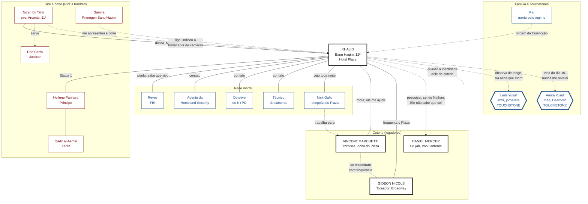

#jogador #auld-sanguine #khalid #readme

# Khalid Hassan Yusuf: o que você sabe

> Nova York · Dezembro de 2021
> Este arquivo é **só seu**. Reúne o que Khalid sabe e as relações dele com os outros personagens, do ponto de vista dele. Não repasse aos outros jogadores.

## Sumário
- [[#Como ler este arquivo]]
- [[#Onde você está em 2021]]
- [[#Seu sire: Nizar ibn Tahir]]
- [[#Sua família e seus Touchstones]]
- [[#Sua rede mortal]]
- [[#A coterie: os outros jogadores]]
- [[#A corte e outros NPCs Kindred]]
- [[#Mapa de relacionamentos]]
- [[#Os segredos que você guarda]]
- [[#O que os outros sabem de você]]

---

## Como ler este arquivo

| Marca | Quem é |
|---|---|
| 🎭 **Jogador** | Personagem de outro jogador da mesa (a coterie). Quem os conduz decide o que eles fazem; você só controla o que Khalid sabe e faz. |
| 🩸 **NPC Kindred** | Vampiro conduzido pelo Narrador. |
| 👤 **NPC mortal** | Humano conduzido pelo Narrador. |
| 🕯️ **Touchstone** | Ligação humana que segura a sua Humanidade (de NPC mortal). |

Tudo aqui é o que **Khalid** sabe ou acredita. Pode haver coisas que ele ignora, e algumas crenças dele podem estar erradas.

---

## Onde você está em 2021

- **Há 11 anos** (2010, Washington D.C.) você foi Abraçado no clã Banu Haqim. É **12ª geração** (sim, 12ª).
- Você mora de forma permanente no **Hotel Plaza**, em Nova York, **desde cerca de 2011**. Foi a Camarilla de Nova York que o colocou ali, e o dono do hotel, Vincent, ficou **encarregado de ajudá-lo**.
- Sua cobertura é **consultor de segurança do hotel**, com a identidade falsa e a credencial que você já tinha. Isso lhe dá motivo para circular pelas câmeras, pela segurança e pela equipe.
- Você é oficialmente **morto desde 2010**. Mãe e irmã acreditam nisso.
- Na corte, seu Status é 1: **Membro reconhecido e confiável**.
- Você já passou anos observando os outros três da coterie. Eles sabem que você é do clã Banu Haqim e que mora no Plaza; sobre o resto, ver [[#O que os outros sabem de você]].

---

## Seu sire: Nizar ibn Tahir

🩸 **NPC Kindred.** Banu Haqim, **11ª geração**, ancilla, **Arconte do Justicar Don Cerro**.

- Foi ele quem tirou sua família do Oriente Médio depois que seu pai foi assassinado pelo regime. **Não pediu nada em troca.**
- Em 2010 voltou para cobrar a dívida: viu em você um caçador nato e o Abraçou. Para a ficha ele é seu **Mawla (1)**: um mentor distante que ajuda quando lhe convém.
- Ele **viaja muito** a serviço do Justicar, por isso você o vê pouco.
- Você sabe quem ele é e **não contou à coterie**.
- Nizar **liga de tempos em tempos**. Pergunta como você está, como vai o hotel, quem tem passado por lá.
- Foi por **indicação dele** que você escolheu o fornecedor e trocou o sistema de segurança do hotel (câmeras, etc).

🩸 **Don Cerro** (Justicar) é o superior de Nizar. Você sabe disso e pouco mais: nunca o encontrou.

---

## Sua família e seus Touchstones

Seus Touchstones são os dois lados da mesma ferida: você os protege ficando morto, e ficando morto abandonou os dois.

| Pessoa | Quem é | O que você sabe |
|---|---|---|
| 🕯️ **Leila Yusuf** (👤 NPC mortal) | Sua irmã mais nova. Jornalista investigativa. Mora e trabalha em **Nova York**, na redação do ***The Harbor Ledger***. | Ela acredita que você morreu em 2010. Ligada à sua Convicção *\"A verdade precisa vir à tona, custe o que custar.\"* Por ofício, ela é a pessoa mais capaz de expor o que você esconde. A cidade é a mesma para os dois. |
| 🕯️ **Amira Yusuf** (👤 NPC mortal) | Sua mãe, viúva. Mora em **Dearborn, Michigan**. | Acende uma vela por você **todo dia 10 de cada mês**. Você a observa de longe e nunca se revelou. Ligada à Convicção *\"Nunca abandonar quem depende de mim.\"* |
| **Seu pai** (👤 NPC mortal, morto) | Professor e repórter assassinado pelo regime. | Origem da sua obsessão por justiça. Ligado à Convicção *\"Nenhum tirano merece escapar da justiça\"*, que **não tem Touchstone**. |

---

## Sua rede mortal

Todos 👤 **NPCs mortais**, conduzidos pelo Narrador.

| Quem | Papel | O que você sabe |
|---|---|---|
| **Reyes** | Agente do **FBI** no escritório de Nova York. Seu aliado (Allies 2). | Foi seu parceiro numa força-tarefa conjunta. **Sabe que você está vivo** e acredita que você trabalha num programa sigiloso. |
| **Agente da Homeland Security** | Contato. | Ainda atende o celular, o ponto do seu Predator Type. |
| **Detetive do NYPD** | Contato. | Fonte de informação em Nova York. |
| **Técnico de câmeras** | Contato. | Tem acesso a câmeras de segurança na cidade. |
| **Nick Gallo** | Recepcionista do Plaza. | Você o vê toda noite. Trabalha na recepção do hotel de Vincent. |

---

## A coterie: os outros jogadores

Os seis 🎭 são **jogadores**. Ao longo dos anos você **pesquisou** Vincent, Gideon e Daniel. Gusman é diferente: foi você quem o achou, com Gideon. Nina é a pupila de Gideon, e você a conhece pessoalmente das visitas dela ao Plaza. Herta é uma hóspede recém-chegada, que você só viu de passagem. Os laços entre vocês são cinzentos: ninguém é melhor amigo de ninguém.

##### 🎭 Vincent Marchetti, o dono do Plaza
- **Tzimisce**, **ex-Sabbat** (nascido na seita), hoje na Camarilla de Nova York.
- Dono do **Hotel Plaza**, onde você mora. A Camarilla o encarregou de ajudá-lo. Vocês convivem há cerca de dez anos.
- **Herói de guerra** da Camarilla pela Batalha de Nova York de 1999.
- Você conhece a segurança do hotel por dentro; ele conhece o hotel inteiro.
- **Gusman:** você e Gideon o chamaram por ser ex-Sabbat. Ele viu a marca e deu **cobertura** a Gusman nas primeiras semanas. Ele **não sabe o nome verdadeiro** de Gusman. Ver [[#🎭 Gusman Gutierrez, o rapaz do metrô]].

##### 🎭 Gideon Nicols, o produtor
- **Toreador**, produtor da **Broadway**.
- Sem cargo oficial na corte, mas com muito poder em **favores e informação**. Tem reconhecimento entre anciões pelo trabalho de bastidores na Batalha de 1999.
- Dá festas no Plaza. Ele e Vincent **se encontram regularmente**.
- Você sabe muito pouco da vida mortal dele.
- **Gusman:** Gideon é o **responsável** por ele e foi quem decidiu que o rapaz ficaria escondido. Foi para ele que você entregou o nome verdadeiro de Gusman. Ver [[#🎭 Gusman Gutierrez, o rapaz do metrô]].
- **Nina:** Gideon é o **Mawla** dela, à vista da corte, e a leva ao Plaza vez ou outra. Ver [[#🎭 Nina "Blue" Calloway, a pupila de Gideon]].

##### 🎭 Daniel Mercer, o nômade
- **Brujah**, ligado ao clube de motociclistas **Iron Lanterns**. Esteve na guerra de 1999.
- Foi o mais **fácil de rastrear**: foi Abraçado mais recentemente que os outros, e tem um **filho** com registros em hospital.
- 🔒 **Você sabe**: o filho se chama **Nathan** e está doente (registros desde 2020; o sobrenome nos arquivos é **Ward**). **Daniel não sabe que você sabe.** Guarde, e decida o que fazer com isso.
- **Daniel não sabe de Gusman** e fica de fora do segredo.

##### 🎭 Nina "Blue" Calloway, a pupila de Gideon
- **Toreador** neonata, 13ª geração, **saxofonista** da cena de jazz do Harlem. Abraçada em **novembro de 2020**. **Gideon é o Mawla** dela.
- **Abraço irregular.** O sire dela a Abraçou **sem permissão do Príncipe** e foi **levado pela Camarilla** pouco depois. A corte a **tolera e vigia** (ela é *Suspect*). O destino do sire é desconhecido para ela.
- Você **a conhece pessoalmente**: Gideon a leva ao Plaza vez ou outra, e você a vê lá. Sabe o que circula dela na corte.
- Ela toca num porão da **Lenox Avenue**, mantido por **Augie Mendez**, e se alimenta da plateia fiel da cena.
- Você a vê com um olhar que poucos teriam: foi **Abraçada sem escolher**, por causa de um talento, como você foi por uma dívida. Você sabe o que custa a um recém-Abraçado manter a vida de antes escondida de quem ama, e pode avisá-la, ou calar.
- Na noite do Réveillon, quando a história começar, **ela vai precisar da sua investigação**: não tem perícia para isso.
- **Gusman:** ela ainda não o conhece. Os dois vão se cruzar, e você sabe o que ele esconde. Ver [[#🎭 Gusman Gutierrez, o rapaz do metrô]].

##### 🎭 Gusman Gutierrez, o rapaz do metrô
- **Ravnos** de 13ª geração, Abraçado em 2018, **sem sire conhecido**. Mora em **Staten Island**. **Gideon é o responsável** por ele. 🔒 **Ele não sabe que é Ravnos.**
- **Como vocês o acharam:** Gideon procurava um **Ravnos sobrevivente da Semana de Pesadelos** e usava você para vigiar quem entrava e saía do domínio, com seus contatos na polícia e com técnicos de câmera. Em **março de 2018** acharam o rapaz **recém-Abraçado**, acordando numa **estação do metrô** da 50th Street, com uma **marca escrita no peito** (sânscrito misturado com a marca de Caim, com ar de Sabbat) que ninguém decifrou.
- **A gravação é sua.** Você viu numa câmera uma **figura encapuzada** escrever a marca, **virar para a câmera sem mostrar o rosto**, dar um **meio sorriso**, e a **câmera cortar**. Você não sabe quem é.
- **O segredo:** vocês três (você, Gideon e Vincent, que **sabe que Gusman é Ravnos**) decidiram **não expor Gusman à Camarilla**. Gideon argumentou que "informação vale ouro".
- **A sua parte é investigar a origem dele.** Você achou o **orfanato** em Newark (a Casa Santa Rita, fechada em 2016), a anotação "**N.N.**" no arquivo da diocese e, em **um ou dois anos** (2019 a 2020), o **nome verdadeiro**: **Julian Jiménez**. Você passou o nome a Gideon. Você **sabe onde Julius mora** e **onde Mike esteve preso** (ele só saiu em **2020**; hoje você sabe onde mora), mas **nunca os procurou**.
- **O nome é só um dado para você.** Você **não sabe** que ele tem qualquer importância além de ser o resultado da sua investigação.
- **Ele sabe quase nada da sociedade vampírica** e evita outros Kindred. **Gideon lhe explicou que ele é provavelmente um Caitiff**, e você (com Vincent) sustentou isso. **Nem ele sabe que é Ravnos.** Se perguntarem, ele diz **com sinceridade** que não sabe de que "tipo de vampiro" é. Ninguém de fora sabe que é Ravnos. Se ele lhe perguntar direto, **você decide** se mente ou diz a verdade.
- **Alimentação:** primeiro, bolsas desviadas por vocês. Depois, o enfermeiro **Marcus Bell**, que Gideon conheceu por uma artista dele, **Tessa Lang**. Hoje Gusman se vira sozinho.
- ⚠️ **O risco:** esconder um Abraço fere a **Terceira Tradição (Progeny)**. O arquivo que você montou sobre Mike e Julius, se cair em mãos erradas, entrega o nome e os amigos.

##### 🎭 Herta Müller, a hóspede da comitiva
- **Ventrue** neonata, recém-chegada da Alemanha com uma **comitiva da Camarilla europeia** (ver [[#A comitiva europeia]]). Está no Plaza desde **terça, 28/12**.
- Como consultor de segurança, você **registrou a chegada**: três Kindred e um mortal que não sai do lado do chefe. Na quinta, **30/12**, as câmeras mostraram os outros três saindo com bagagem. **Ela ficou sozinha** no hotel.
- Vocês **se cruzaram** algumas vezes no saguão e no elevador. Um aceno, uma ou duas frases, em inglês com sotaque alemão. Nenhum dos dois puxou conversa.
- Você reparou que ela **observa as pessoas como quem lê um depoimento**: demora nos rostos e repara quando alguém hesita.
- Sabe por Vincent que o sire dela a deixou **aos cuidados dele**.

---

## A corte e outros NPCs Kindred

Todos 🩸 **NPCs Kindred**. Esta é a corte de Nova York em 2021 como você a conhece, e os Anarquistas.

##### A corte

| Quem | Papel | O que você sabe |
|---|---|---|
| **Nizar ibn Tahir** | Seu sire. | Ver [[#Seu sire: Nizar ibn Tahir]]. |
| **Don Cerro** | Justicar, superior de Nizar. | Nunca o encontrou. |
| **Hellene Panhard** | **Príncipe** de Nova York (Ventrue). | Autoridade da Camarilla na cidade, no cargo desde cerca de 2005, depois de Calebros. Você é um Membro reconhecido dentro do domínio dela. |
| **Qadir al-Asmai** | **Xerife** de Nova York (Toreador). | Faz cumprir a lei da corte. Foi **Arconte de Don Cerro**, o mesmo Justicar do seu sire, e Xerife de Calebros antes de Panhard. |
| **Valerie Duval** | **Scourge** (Ventrue). | Neonata. Caça thin-bloods e é dura com os que saem da linha. Age sob as ordens do Xerife. |
| **Thomas Arturo** | **Herald**, a Harpia da corte (Toreador). | Dono de reputações e escândalos; a influência dele é comparável à de um Primogen. Dizem que favorece Ventrue, Toreador e Tremere. |
| **Aisling Sturbridge** | **Alta Regente da Capela dos Cinco Distritos** (Tremere). | Líder dos Tremere na cidade. Esperta e estratégica; faz acordos com outros Membros, o que é raro entre os Tremere. |
| **Julia Sowinski** | **Primogen** Lasombra. | Neonata, Abraçada em junho de 2019. Era jornalista investigativa e investigou a morte de Callihan, em 2020. |
| **Samira** | **Primogen dos Banu Haqim** em Nova York. | Foi quem o **apresentou à corte** em 2010 ou 2011. Depois disso, **contato mínimo**. Você a conhece pouco. |
| **Katherine Weiss** | **Primogen dos Brujah** (leal da Camarilla). | Representa os Brujah que ficaram na Camarilla depois de 2012. Você a conhece só de nome. |
| **Calebros** | **Príncipe interino** depois da Batalha de Nova York (Nosferatu). | Governou a cidade logo depois da guerra de 1999, até Panhard assumir. Você chegou depois: só o conhece de nome. |

##### A comitiva europeia

Hospedada no Plaza de **28 a 30/12**. Você sabe o que as câmeras e o registro do hotel mostram, e o pouco que circula na corte.

| Quem | Papel | O que você sabe |
|---|---|---|
| **Heinrich von Altenfeld** | Ventrue de Berlim; chefia a comitiva. Sire de Herta. | Velho, formal, ex-diplomata. Foi apresentado à Príncipe em **29/12** e saiu do hotel em **30/12** para uma residência dela, para as festas de fim de ano. |
| **Teodoro Castellví** | **Lasombra** de Barcelona. | Na corte, dizem que a comitiva veio ver **como Nova York integrou os Lasombra**, e ele é a prova viva. Saiu com Heinrich. |
| **Lorenz Kehl** | Secretário e motorista de Heinrich. | Mortal. Pelo que você viu nas câmeras, não dorme quando o patrão acorda: carniçal, quase certo. |

##### Anarquistas

A Camarilla reivindica a cidade inteira, mas os Anarquistas ficam quase só no **Bronx**.

| Quem                        | Papel                   | O que você sabe                                                                                                               |
| --------------------------- | ----------------------- | ----------------------------------------------------------------------------------------------------------------------------- |
| **Douglas "Boss" Callihan** | Barão Anarch, o "Boss". | Foi encontrado **morto em março de 2020**. Dizem que era aliado e amante da Príncipe.                                         |
| **Torque**                  | Brujah, Barão Anarch.   | **Novo líder presumido** depois de Callihan, acusado de trair as raízes do movimento.                                         |
| **Tamika**                  | Gangrel, Anarch.        | Caça agentes do governo que perseguem vampiros; foi ligada a Torque. Você, ex-Homeland Security, conhece o tipo que ela caça. |

---

## Mapa de relacionamentos

Visto de **Khalid**. Convenções: preto = jogador (🎭); vermelho = NPC Kindred (🩸); azul = NPC mortal (👤); azul com borda grossa = Touchstone (🕯️). Linha cheia = você sabe e é recíproco; linha tracejada = você sabe e o outro **não sabe**, ou é uma ligação distante.

---

## Os segredos que você guarda

- **Você está vivo.** Mãe e irmã acreditam que morreu em 2010, e você as vigia de longe.
- **A dívida com Nizar.** Você foi Abraçado como cobrança de um favor que nunca pediu.
- **A identidade do seu sire.** Ninguém da coterie sabe quem ele é nem que é Arconte; você a guarda.
- **O que você sabe de Nathan.** Você rastreou o filho de Daniel por registros de hospital, e Daniel não sabe.
- **Reyes acredita numa mentira.** Ele pensa que você trabalha num programa sigiloso.
- **O seu lado da Sede de Justiça.** A Compulsion de Judgment faz do castigo uma refeição, e a Prey Exclusion (só se alimenta de quem fez algo errado) pode virar álibi.
- **O arquivo de Gusman.** Você tem o orfanato, o "N.N." do arquivo da diocese, Mike e Julius e a gravação da figura encapuzada. Nem tudo isso é conhecido de Vincent, e Daniel não sabe de nada.
- **Mike e Julius.** Você sabe onde moram e nunca os procurou.

---

## O que os outros sabem de você

- Sabem que você é **Banu Haqim**, que mora no **Plaza** há cerca de dez anos e que cuida da segurança do hotel.
- Sabem que você tem um sire, mas **você nunca disse quem é**.
- **Não sabem** que você os pesquisou, nem o que descobriu.
- **Não sabem** da sua família nem que você está "morto" para ela.
