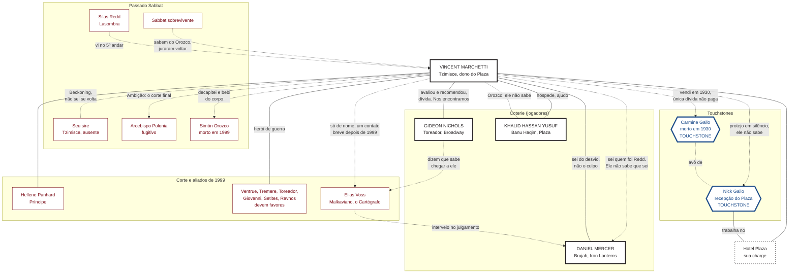

#jogador #auld-sanguine #vincent #readme

# Vincent Marchetti: o que você sabe

> Nova York · Dezembro de 2021
> Este arquivo é **só seu**. Reúne o que Vincent sabe e as relações dele com os outros personagens, do ponto de vista dele. Não repasse aos outros jogadores.

## Sumário
- [[#Como ler este arquivo]]
- [[#Onde você está em 2021]]
- [[#Seu sire e o Sabbat]]
- [[#Seus Touchstones]]
- [[#O Plaza e as pessoas que o mantêm]]
- [[#A coterie: os outros jogadores]]
- [[#A corte, os aliados de 1999 e outros NPCs]]
- [[#Elias Voss, o Cartógrafo]]
- [[#Mapa de relacionamentos]]
- [[#Os segredos que você guarda]]
- [[#O que os outros sabem de você]]

---

## Como ler este arquivo

| Marca | Quem é |
|---|---|
| 🎭 **Jogador** | Personagem de outro jogador da mesa (a coterie). Quem os conduz decide o que eles fazem; você só controla o que Vincent sabe e faz. |
| 🩸 **NPC Kindred** | Vampiro conduzido pelo Narrador. |
| 👤 **NPC mortal** | Humano conduzido pelo Narrador. |
| 🕯️ **Touchstone** | Ligação humana que segura a sua Humanidade (de NPC mortal). |

Tudo aqui é o que **Vincent** sabe ou acredita. Pode haver coisas que ele ignora, e algumas crenças dele podem estar erradas.

---

## Onde você está em 2021

- **Tzimisce**, o **Porteiro**. Nasceu em 1908 em Little Italy, virou **carniçal** em 1931 e foi **Abraçado em 1957**, durante a Terceira Guerra Civil do Sabbat. São cerca de 64 anos como Kindred.
- Você é **dono do Hotel Plaza**, onde começou como porteiro. Hoje cuida de tudo: gerência, contas, favores devidos e as pessoas que dormem lá.
- Você é **ex-Sabbat** e **herói de guerra da Camarilla**: em 1999 deu o plano e as informações que derrubaram o Sabbat de Nova York.
- O seu **Bane**: o Plaza e as pessoas que o mantêm são sua *charge*. Afastar-se deles causa sofrimento, e o único lugar onde o corpo não cobra o preço é dentro do hotel.
- Você **não bebe de mortais** (não é virtude: eles sustentam o Plaza). Bebe de Kindred, o que considera honesto e corre riscos.
- A Camarilla de Nova York o respeita, mas **ninguém lhe pergunta como cortou aquela cabeça**.

---

## Seu sire e o Sabbat

| Quem | O que você sabe |
|---|---|
| 🩸 **Seu sire** (Tzimisce, nome a definir) | Comprou o Plaza em 1931, o transformou em carniçal e depois o Abraçou por **utilidade**: você era o único que conhecia a contabilidade inteira. Era paranoico, dormia cercado pelo que considerava seu, e manteve laços com a Camarilla de Nova York, o que no Sabbat era traição. **Partiu com o Beckoning, sem avisar nem se despedir.** O Plaza ficou. Você não sabe se ele volta, nem se quer que volte. |
| 🩸 **Sabbat sobrevivente** | Alguns fugiram com o arcebispo e **juraram voltar**. Eles o odeiam, e sabem o que aconteceu com o corpo de Orozco. É o inimigo que você carrega. |
| 🩸 **Arcebispo Polonia** | Escapou do Bronx em 1999 por uma rota que você pediu para fechar. Foi o **único erro** de uma campanha sem erros, e não foi seu. Paradeiro desconhecido. A sua **Ambição** é achar Polonia e fazer pessoalmente o corte final. |
| 🩸 **Simón Orozco** | Bispo, braço direito do arcebispo. Morreu em 1999, num trem em Grand Central. |

---

## Seus Touchstones

| Convicção | Pessoa | O que você sabe |
|---|---|---|
| *"Toda dívida se paga."* | 🕯️ **Carmine Gallo** (👤 NPC mortal, morto em 1930) | Seu chefe na Lei Seca, que lhe deu o primeiro trabalho de verdade. Você o **vendeu a um rival em 1930**, porque a conta dava mais lucro. É a única dívida que você nunca pagou. (Está na sua ficha como Touchstone, mas já morreu; vale alinhar com o Narrador.) |
| *"Olhe por aqueles que você sabe que estão com você."* | 🕯️ **Nick Gallo** (👤 NPC mortal) | Neto de Carmine. Você mandou contratá-lo na recepção do Plaza sem ele saber por quê. Tem o mesmo jeito de contar o troco do avô e a mesma risada curta. Não sabe quem você é nem o que aconteceu com o avô. |

---

## O Plaza e as pessoas que o mantêm

| Quem | O que você sabe |
|---|---|
| 👤 **Nick Gallo** | Recepcionista. Ver [[#Seus Touchstones]]. |
| 👤 **Equipe do Plaza** | Funcionários, contatos e ambiente que sustentam o hotel. É o seu patrimônio. |
| 🎭 **Khalid** | Residente permanente desde cerca de 2011. A Camarilla o encarregou de ajudá-lo. Ele reformulou o sistema de segurança do hotel (câmeras, etc.). |
| 🎭 **Herta Müller** | Hóspede desde **28/12**, com a comitiva europeia. Desde **30/12** está sozinha no hotel, e o sire dela a deixou **aos seus cuidados**. Ver [[#🎭 Herta Müller, a hóspede da comitiva]]. |

---

## A coterie: os outros jogadores

Os seis 🎭 são **jogadores**. Os laços entre vocês são cinzentos: ninguém é melhor amigo de ninguém, mas todos têm história com todos. Nina é a mais nova da cidade e a que você conhece menos. Herta acabou de chegar: você a conhece há três noites.

### 🎭 Gideon Nicols, o produtor
- **Toreador**, produtor da **Broadway**, sem cargo mas com muito poder em favores e informação.
- Vocês se **conheceram e se ajudaram na Batalha de Nova York**: informação de refúgios de um lado, a sua lista do outro.
- **Gideon o avaliou em 1999 juntamente de sua sire na época, e o recomendou à Camarilla como confiável.** Você lhe deve ter sido aceito (uma **dívida relativa**), mas ele também se beneficiou do que você entregou.
- O Plaza é palco natural de algumas **festas** dele. Vocês **se encontram regularmente**.

- Dizem que **Gideon costuma saber como chegar a Elias Voss** (ver [[#Elias Voss, o Cartógrafo]]). É o que você sabe; os detalhes são dele.
- **Gusman:** Gideon é o **responsável** por ele e foi quem argumentou pelo segredo. Ver [[#🎭 Gusman Gutierrez, o rapaz do metrô]].
- **Nina:** Gideon é o Mawla dela, à vista da corte. Ver [[#🎭 Nina "Blue" Calloway, a pupila de Gideon]].

### 🎭 Daniel Mercer, o nômade
- **Brujah**, do motoclube **Iron Lanterns**. Esteve na guerra de 1999, mas em **lado oposto ao seu**: você deu o plano da Camarilla; ele foi usado por um sire que quis lucrar com a mesma guerra.
- 🔒 **Você sabe quem foi Silas Redd.** Como porteiro, viu o Lasombra subir ao quinto andar do Plaza. **Daniel não sabe que você o conheceu.**
- Você sabe que Daniel teve **envolvimento no desvio de tropas** em 1999. **Você não o culpa.**
- Vocês dois querem **acabar com a guerra**: você, pegando Polonia; ele, protegendo o que Doc deixou para trás.
- **Daniel não sabe de Gusman** e fica de fora do segredo.

### 🎭 Khalid Hassan Yusuf, o seu hóspede
- **Banu Haqim**, residente permanente do Plaza e **consultor de segurança** do hotel. A Camarilla o encarregou de ajudá-lo; vocês convivem há cerca de dez anos.
- Você não sabe quem é o sire dele; ninguém na coterie sabe.
- **Khalid não sabe nada do que você fez com o corpo de Orozco.** Se descobrir, talvez reaja.
- **Gusman:** foi Khalid quem filmou a gravação e quem investiga a origem do rapaz. Ver [[#🎭 Gusman Gutierrez, o rapaz do metrô]].

### 🎭 Nina "Blue" Calloway, a pupila de Gideon
- **Toreador** neonata, 13ª geração, **saxofonista** da cena de jazz do Harlem. Abraçada em **novembro de 2020**. **Gideon é o Mawla** dela.
- **Abraço irregular.** O sire dela a Abraçou **sem permissão do Príncipe** e foi **levado pela Camarilla** pouco depois. A corte a **tolera e vigia** (ela é *Suspect*). O que você sabe do caso circula na corte: nada além disso.
- Você **a conhece pessoalmente**: Gideon a leva ao Plaza vez ou outra, e você a recebe lá como a pupila dele.
- Como dono do Plaza, você sabe que **quem vigia Nina pode passar por aqui**, atrás de Gideon.
- **Gusman:** ela ainda não o conhece. Ver [[#🎭 Gusman Gutierrez, o rapaz do metrô]].

### 🎭 Gusman Gutierrez, o rapaz do metrô
- **Ravnos**, recém-Abraçado em 2018, **sem sire conhecido**, achado por **Gideon e Khalid** numa estação de metrô, com uma **marca escrita no peito**. **Gideon é o responsável** por ele. Ele mora em **Staten Island**. 🔒 **Ele não sabe que é Ravnos.**
- **Como você entrou:** os dois o procuraram por ser **ex-Sabbat**. Você viu a marca (sânscrito misturado com a marca de Caim). **Reconheceu o estilo do Sabbat, mas não o rito**, e não soube lê-la. Viu também a gravação da **figura encapuzada** que a escreve, com o **meio sorriso**.
- **A sua parte:** nas primeiras semanas você deu **cobertura**, **um quarto fora do registro do Plaza**, para que o rapaz não aparecesse nos livros.
- **O segredo:** vocês três decidiram **não expor Gusman à Camarilla** sem provas mais concretas. Gideon argumentou que "informação vale ouro".
- **Gusman sabe quase nada da sociedade vampírica** e evita outros Kindred. **Gideon lhe explicou que ele é provavelmente um Caitiff**, e você (com Khalid) sustentou isso. **Nem ele sabe que é Ravnos.** Se perguntarem, ele diz **com sinceridade** que não sabe de que "tipo de vampiro" é. Ninguém de fora sabe que é Ravnos. Se ele lhe perguntar direto o que é, **você decide** se mente ou diz a verdade.
- **O que você não sabe:** o **nome verdadeiro** dele. Khalid investigou a origem dele, mas **nunca lhe contou o nome**.
- ⚠️ **O risco:** esconder um Abraço fere a **Terceira Tradição (Progeny)**. Você é **herói de guerra** e o **Plaza** foi onde ele ficou escondido. Se o **Xerife Qadir** descobrir, você também responde.

### 🎭 Herta Müller, a hóspede da comitiva
- **Ventrue** neonata, 13ª geração, Abraçada em Berlim no **outono de 2021**. Ex-diplomata alemã; a fachada dela é a **Missão Permanente da Alemanha junto à ONU**.
- **Progênie de Heinrich von Altenfeld**, que chefia a comitiva europeia (ver [[#A comitiva europeia]]).
- Está no Plaza desde **terça, 28/12**. Na quinta, **30/12**, o resto da comitiva saiu para as festas de fim de ano numa residência da Príncipe. **Ela ficou.** Na noite de 31, completa três noites no hotel.
- **Antes de sair, Heinrich a deixou aos seus cuidados**: pediu que você atendesse às necessidades dela e disse a ela para chamá-lo se precisasse de algo. É uma hóspede, e mais do que isso: alguém por quem você agora responde dentro do Plaza.
- Você a conhece pouco: sabe que é educada, observa muito e fala pouco. Não sabe por que o sire não a levou junto.
- Ela não conhece a coterie. Khalid só cruzou com ela no saguão.

---

## A corte, os aliados de 1999 e outros NPCs

Todos 🩸 **NPCs Kindred**, salvo indicação.

##### A corte em 2021

| Quem | Papel | O que você sabe |
|---|---|---|
| **Hellene Panhard** | **Príncipe** de Nova York (Ventrue). | Autoridade da Camarilla na cidade, no cargo desde cerca de 2005, depois de Calebros. |
| **Qadir al-Asmai** | **Xerife** (Toreador). | Ex-Arconte. Foi Xerife de Calebros e depois de Panhard. Faz cumprir a lei da corte: é ele quem importa se o segredo de Gusman vazar. |
| **Valerie Duval** | **Scourge** (Ventrue). | Neonata que caça thin-bloods e age sob as ordens do Xerife. |
| **Thomas Arturo** | **Herald**, a Harpia da corte (Toreador). | Dono de reputações e escândalos; a influência dele é comparável à de um Primogen. Dizem que favorece Ventrue, Toreador e Tremere, três dos clãs que lhe devem favores. |
| **Aisling Sturbridge** | **Alta Regente da Capela dos Cinco Distritos** (Tremere). | Líder dos Tremere da cidade, o clã que o ajudou com Orozco em 1999. |
| **Julia Sowinski** | **Primogen** Lasombra. | Neonata, Abraçada em junho de 2019. Era jornalista investigativa. O clã que mandava no Sabbat que você conheceu hoje tem assento na Camarilla. |
| **Samira** | **Primogen dos Banu Haqim**. | O clã de Khalid, seu hóspede. |
| **Katherine Weiss** | **Primogen dos Brujah** (leal da Camarilla). | Representa os Brujah que ficaram na seita depois de 2012. O clã de Daniel, que esteve do outro lado em 1999. |
| **Calebros** | **Príncipe interino** depois da Batalha de 1999 (Nosferatu). | Declarou a moratória ao Embrace e recebeu você como herói de guerra. Governou até Panhard assumir, por volta de 2005. |

##### A comitiva europeia

Hospedada no Plaza de **28 a 30/12**. Desde **30/12**, só Herta continua no hotel. A comitiva fica na cidade pelo menos até a primeira semana de janeiro.

| Quem | Papel | O que você sabe |
|---|---|---|
| **Heinrich von Altenfeld** | Ventrue de Berlim, Abraçado em 1887; chefia a comitiva. Sire de Herta. | Ex-diplomata do Império Alemão. Conversou com você mais de uma vez, cortês, com perguntas sobre 1999 e sobre como é ser ex-Sabbat na Camarilla. Parecia tomar notas. Deixou Herta aos seus cuidados. |
| **Teodoro Castellví** | **Lasombra** de Barcelona. | Entrou na Camarilla com a deserção de parte do clã, em 2018. O motivo público da comitiva é ver como Nova York integrou os Lasombra. Um Lasombra dormiu no seu hotel: o clã que mandava no Sabbat que você traiu. |
| **Lorenz Kehl** (👤) | Secretário e motorista de Heinrich. | Mortal, ou quase: cuida de documentos e carros, e não dorme quando o patrão acorda. Você aposta que é carniçal. |

##### Aliados de 1999 e outros

| Quem | Papel | O que você sabe |
|---|---|---|
| **Ventrue, Tremere, Toreador** | Aliados da Batalha de 1999. | Você deu o roteiro; eles lhe **devem favores**. |
| **Giovanni, Setites, um Ravnos** | Aliados da Batalha de 1999. | Idem. Os Giovanni olharam para o outro lado porque você levou a oferta no preço certo. |
| **Tremere** | Entregaram o cabelo de Orozco e o localizaram. | Participaram da morte dele em Grand Central. |
| **Silas Redd** | Intermediário Lasombra do Sabbat. | Você o viu no Plaza, no quinto andar. Destino desconhecido desde 1999. |
| **Elias Voss** | Malkaviano, conselheiro tolerado, "O Cartógrafo". | Ver [[#Elias Voss, o Cartógrafo]]. Você sabe pouco dele. |

##### Anarquistas

A Camarilla reivindica a cidade inteira, mas os Anarquistas ficam majoritariamente no **Bronx**, o bairro onde você fechou o complexo de Polonia em 1999, com uma presença significativa em **Staten Island**.

| Quem | Papel | O que você sabe |
|---|---|---|
| **Douglas "Boss" Callihan** | Barão Anarch, o "Boss". | Foi encontrado **morto em março de 2020**. Dizem que era aliado e amante da Príncipe. |
| **Torque** | Brujah, Barão Anarch. | **Novo líder presumido** depois de Callihan, acusado de trair as raízes do movimento. |
| **Mia Morgan** | Brujah, Anarch. | Do coterie **Midnighters**. |
| **Tamika** | Gangrel, Anarch. | Caça agentes do governo que perseguem vampiros; foi ligada a Torque. |

---

## Elias Voss, o Cartógrafo

🩸 **NPC Kindred.** Malkaviano. Você é dos membros mais antigos da cidade e já ouviu falar das figuras que pesam nela. Elias é uma delas, mas **você o conhece menos do que Gideon**.

- Você o conhece **de nome e de reputação**: um Malkaviano antigo, **sem cargo**, que a corte tolera e consulta. Quem pede conselho a ele raramente entende a resposta na hora.
- Você ouviu, pelos aliados de 1999, que ele **interveio no julgamento de um Brujah** (Daniel) em campo. Não sabe os detalhes.
- Teve **um contato breve**, nas semanas depois da Batalha: ele passou por você, traçou uma rota com o dedo na margem de um papel do Plaza e foi embora. Você nunca soube se foi um aviso, uma piada ou nada.
- Não sabe onde ele vive nem quem são os intermediários dele. Sabe por reputação que **Gideon costuma saber como chegar a ele**.

---

## Mapa de relacionamentos

Visto de **Vincent**. Convenções: preto = jogador (🎭); vermelho = NPC Kindred (🩸); azul = NPC mortal (👤); azul com borda grossa = Touchstone (🕯️). Linha cheia = você sabe e é recíproco; linha tracejada = você sabe e o outro **não sabe**, ou é uma ligação distante.

---

## Os segredos que você guarda

- **O corte e o sangue de Orozco.** Você o decapitou pessoalmente e bebeu do corpo, de forma deliberada. O Sabbat sobrevivente sabe; a Camarilla não.
- **A traição a Carmine.** Em 1930 você vendeu o chefe a um rival. Ninguém na mesa sabe.
- **O motivo de contratar Nick.** Ele não sabe quem você é nem o que aconteceu com o avô.
- **Silas Redd.** Você sabe quem ele foi e o viu no Plaza. Daniel não sabe que você o conheceu.
- **Origem Sabbat.** Seu sire manteve laços com a Camarilla de Nova York; você cresceu e foi Abraçado dentro do Sabbat.
- **Gusman.** Você escondeu um quarto e participa de um segredo contra a Terceira Tradição. Daniel não sabe.

---

## O que os outros sabem de você

- **Gideon** sabe que você deu à Camarilla o plano de 1999, que ele o avaliou e o recomendou e que vocês se encontram regularmente.
- **Todos** sabem que você é ex-Sabbat, dono do Plaza e herói de guerra. Sabem que Khalid mora no hotel por designação da Camarilla.
- **Daniel** sabe que você deu o plano da Batalha. Não sabe que você conheceu Silas Redd.
- **Ninguém da coterie** sabe o que você fez com o corpo de Orozco, nem de Carmine, nem do motivo de Nick trabalhar na recepção.
