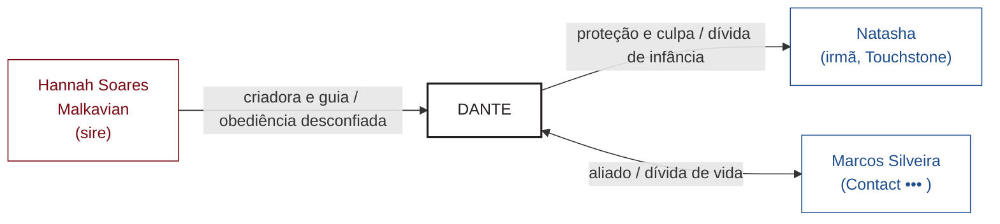

#rules #narrador #relationship-map

# Mapas de Relacionamento (Relationship Maps)

### Sumário
- [[#Para que serve|Para que serve]]
- [[#Convenções do Core|Convenções do Core]]
- [[#Quando o mapa é preenchido|Quando o mapa é preenchido]]
- [[#Como montar na Session Zero|Como montar na Session Zero]]
- [[#Variações dos suplementos|Variações dos suplementos]]
- [[#Como usar durante o jogo|Como usar durante o jogo]]
- [[#Armadilhas|Armadilhas]]
- [[#Formato digital|Formato digital]]
- [[#Versão rápida para uma one-shot|Versão rápida para uma one-shot]]
- [[#Modelo de dados para montar mapas|Modelo de dados para montar mapas]]
- [[#Fontes|Fontes]]

---
## Para que serve

O Relationship Map é o **registro visual de quem cada personagem conhece** e de como essas pessoas se sentem umas sobre as outras: jogadores, sires, Touchstones, aliados, mentores, rivais e os SPCs importantes da cidade. Em V5, "quem você conhece" pesa tanto quanto "quem você é", e por isso o mapa nasce **dentro da criação de personagem**, não depois.

Ele serve para:
- **Ancorar a coterie**: cada personagem já entra ligado a outros dois, então o grupo tem motivo para estar junto (e para brigar).
- **Dar ao Narrador um estoque de ganchos**: toda linha é uma história esperando acontecer (o sire que cobra uma dívida, o Touchstone em perigo, o rival que aparece no Elysium).
- **Lembrar a Humanidade**: os Touchstones ficam visíveis ao lado das Convictions que sustentam.
- **Mostrar poder**: as setas dizem quem manda em quem.
- **Ser uma ferramenta viva**: o mapa muda a cada sessão; romances e rivalidades crescem ou morrem, e o mapa acompanha.

*Fonte: Core, pp. 133 e 142-144 (via notas do app do Pedro, `Core - Criação de Personagem`); New Blood Starter Pack, Introduction.*

---
## Convenções do Core

| Elemento | Convenção |
|---|---|
| **Cores** | **Preto**: personagens dos jogadores, locais e anotações. **Vermelho**: outros Kindred, seus havens e interesses. **Azul**: mortais, suas atividades e bases. |
| **Setas** | Apontam **do lado dominante para o mais fraco**. A seta entre o sire e o personagem aponta para o personagem. Sem seta quando há igualdade de verdade. |
| **Rótulos** | Cada linha leva **um rótulo para cada lado**, escrito perto do nome de cada parte (ex.: "sire superprotetor" de um lado, "ciúme psicótico" do outro; "ghoul", "Blood Bond"). |
| **Sire** | Numa caixa afastada: nome, clã, ano do Embrace e posição conhecida na seita, com a seta apontando para o personagem e uma descrição do Embrace. |
| **Suporte** | Papel grande ("papel de açougue"), mind map digital, deck de slides ou o mapa da cidade com os domains desenhados por cima. |

As relações iniciais **ainda não são** Advantages ou Flaws completos: são esboço. Depois, pode-se pôr dots nelas (Allies, Contacts, Mawla, Enemy, Adversary…).

*Fonte: Core, pp. 142-144 (via notas do Pedro).*

---
## Quando o mapa é preenchido

O mapa acompanha os passos da criação de personagem:

| Passo da criação | O que entra no mapa |
|---|---|
| Core Concept | O nome do personagem, em letras grandes. |
| Clã e Sire | O sire (ou deixe em branco por enquanto) e os SPCs relevantes da seita. |
| Advantages | Todo Ally, Contact, Mawla, Retainer, Herd, Enemy, Adversary e personagem de Loresheet ganha nome e uma linha. |
| Convictions e Touchstones | Cada Touchstone (um mortal por Conviction), ligado ao personagem e anotado com a Conviction que sustenta. |
| Coterie | Os Backgrounds compartilhados e os pré-requisitos do tipo de coterie (Allies, Retainers…). |

*Fonte: Core, pp. 136-137 e 146-147 (via notas do Pedro); Player's Guide, Chapter Three (Characters) e Chapter Five (Coterie, p. 192 em diante, que remete a "V:tM p. 142").*

---
## Como montar na Session Zero

Roteiro do Core, mais conselhos de mesa:
1. **Reserve tempo.** O ideal é uma sessão inteira (Session Zero), com todo mundo junto: montar o mapa em particular, um a um, mata as conspirações que surgem do grupo.
2. **Nomes dos PCs** no centro, em letras grandes.
3. **Dois laços dentro da coterie** para cada personagem: **um positivo e um negativo** com outros dois PCs.
4. **O sire** em caixa afastada, com seta para o personagem e uma frase sobre o Embrace.
5. **Dois Kindred locais da seita** para cada personagem, pedidos ao Narrador (ou emprestados do sire de outro PC): **um positivo e um negativo**.
6. **Touchstones primeiro, depois o resto dos mortais.** Gaste tempo com eles: é quem rende as cenas mais fortes quando ficam para trás, morrem ou são arrastados para a noite.
7. **Advantages e Flaws** viram nomes e linhas.
8. **O Narrador injeta atrito.** Jogadores tendem a escrever só laços bons; o Narrador cruza linhas (o sire que odeia o melhor amigo do PC, o ghoul rival que quer a mesma atenção).
9. **Opiniões fortes, não "???".** Um pouco de mistério é bom, mas cada linha precisa de uma opinião clara para o mundo parecer real.

*Fonte: Core, pp. 142-144 (via notas do Pedro); Nerdist, "GM Tips for Vampire: The Masquerade's 5th Edition Relationship Charts".*

---
## Variações dos suplementos

- **Political Map** (Courts of the Damned, cap. 1): um mapa de quem é quem no poder da cidade, "um Relationship Map da cidade e seus habitantes", destacando pessoas importantes e rivalidades prestes a explodir. Pode ficar separado, com uma cor por facção, ou entrar no mapa da coterie numa cor única e forte. Montá-lo em grupo é um bom começo de crônica política; ligue as **Ambitions** dos PCs a pessoas ou grupos do mapa.
- **"Truths and Lies"** (Chicago by Night): uma lista colaborativa de verdades e boatos da cidade, anotada no verso do mapa, crescendo com a crônica. O Narrador não precisa revelar todos os segredos da cidade ali.
- **Homestead** (Chicago by Night): os valores de Homestead de propriedades e áreas podem ser anotados no próprio mapa.
- **Coteries de SPC** (Chicago by Night): cada coterie de SPC tem seu próprio mapa "no mesmo estilo do V5", mostrando metas comuns e quem se opõe a quem.
- **Night Maps** (Tattered Façade, cap. 1): sistema opcional para montar o distrito. Desenha-se um círculo no centro do mapa com o tipo de distrito; cada jogador acrescenta um local ligado ao seu Predator Type; depois cada um conduz um "Tour" curto por um local, respondendo a uma pergunta sobre o distrito. Locais novos que ganham importância no jogo também entram no mapa.
- **Scene Map** (Blood Sigils, p. 48): versão de cena para rituais/blood craft, que o Political Map imita.
- **Material de mesa:** o New Blood Starter Pack traz um Relationship Map pronto para os 7 personagens pré-gerados, como exemplo de mapa de one-shot.
- **Mortais e ganchos:** os SPCs mortais de Tattered Façade ("The Living (For Now)") são sugeridos como Contacts, Touchstones ou outras conexões do mapa.

*Fontes: Courts of the Damned, Chicago By Night, Tattered Façade, Blood Sigils e New Blood Starter Pack (transcrições no app do Pedro, `vault/bibliografia/`).*

---
## Como usar durante o jogo

- **Antes de cada sessão**, olhe o mapa e escolha uma ou duas linhas para "puxar": um Touchstone que pede ajuda, um sire que aparece, um Ally que cobra um favor.
- **Mudanças de relação são ganchos.** Touchstones podem ser feridos, Abraçados ou deixados para trás; Allies viram Enemies; um Blood Bond se forma.
- **Atualize o mapa** sempre que algo mudar, na hora ou no fim da sessão; ele é o registro vivo da crônica.
- **Use as setas para decisões de SPC**: quem está acima de quem diz como um SPC reage a um pedido.
- **Use a Humanidade**: quando um Touchstone morre ou se perde, a Conviction ligada a ele fica em risco (ver [[Humanidade]]).

*Fontes: Core, pp. 142-144; Nerdist; New Blood Starter Pack.*

---
## Armadilhas

- Montar o mapa em particular ou um a um.
- Deixar tudo positivo e feliz: o mundo fica sem graça.
- Linhas neutras ou "???": o cenário parece desconhecido também para o Narrador.
- Pular ou apressar os Touchstones.
- Esquecer de atualizar: um mapa parado deixa de ser útil.
- Gastar a sessão inteira no mapa sem jogar: numa noite curta, faça o essencial e complete depois.

*Fontes: Nerdist; Other Strangeness, "Lessons from Running My First Game of Vampire: The Masquerade".*

---
## Formato digital

O mapa do Dante (`Dante (Player)/Mapa de Relacionamentos.md`, crônica antiga) foi feito em **Graphviz**: o personagem à esquerda, setas rotuladas saindo dele, e uma nota com a legenda de cada relação. Para o vault, o **Mermaid** é mais prático porque o Obsidian o desenha direto na nota, sem gerar imagem. Exemplo ilustrativo, redesenhando parte do mapa do Dante com as convenções do Core (preto = PC, vermelho = Kindred, azul = mortal; seta do dominante para o mais fraco; os rótulos depois da barra são o lado de quem recebe a seta):

Para mapas grandes (cidade inteira), um quadro livre (Scapple, Excalidraw, Obsidian Canvas) é mais confortável; o Mermaid serve bem para mapas de personagem e de coterie.

*Fontes: Nerdist (Scapple); mapa do Dante no vault.*

---
## Versão rápida para uma one-shot

Para o **Auld Sanguine** (8 jogadores, uma noite), não há tempo para uma Session Zero inteira:
1. **Antes da sessão**, o Narrador monta o mapa a partir das fichas: PCs no centro, sires, Touchstones, Allies/Contacts/Mawla/Enemies das fichas, e os SPCs da aventura ligados a quem tem motivo para conhecê-los (ver [[Personagens da Camarilla de NY]] e [[Camarilla em Nova York]]).
2. **Na abertura (10–15 min)**, cada jogador declara **um laço positivo e um negativo com outro PC**; o Narrador desenha na hora. Com 8 jogadores, faça em roda, uma frase por pessoa.
3. **Durante o jogo**, use o mapa como cola de ganchos: cada cena deve puxar pelo menos uma linha de alguém que ainda não teve destaque.

---
## Modelo de dados para montar mapas

Para eu (Claude) montar mapas a partir das fichas e das notas, cada mapa é uma lista de **nós** e **arestas**:

**Nó**
- `nome`, `tipo` (`pc` · `kindred` · `mortal` · `local` · `grupo`), `clã`/`seita` quando for Kindred;
- `papel` curto (ex.: "sire", "Touchstone de *nunca trair a família*", "Contact •••", "Prince");
- `fonte` (ficha, nota do vault ou página do livro).

**Aresta**
- `de` → `para`, com a direção do **dominante para o mais fraco** (ou sem direção, se forem iguais);
- `rótulo de cada lado` (como cada um vê o outro);
- `tipo`: `sire` · `touchstone` · `blood-bond` · `ally` · `contact` · `mawla` · `retainer` · `herd` · `enemy` · `adversary` · `rival` · `romance` · `família` · `coterie+` · `coterie−` · `dívida` · `facção`;
- `dots`, quando a relação é um Advantage ou um Flaw;
- `fonte`.

**Regras de montagem**
1. Todo PC tem: sire (ou "desconhecido"), seus Touchstones (um por Conviction) e todos os Backgrounds com nome.
2. Todo PC tem pelo menos um laço positivo e um negativo com outro PC (marcados como sugestão até o jogador confirmar).
3. SPCs da cidade entram quando um PC tem motivo para conhecê-los (clã, seita, Status, Mawla, Loresheet, Predator Type).
4. Cores e setas seguem o Core; o mapa é desenhado em Mermaid na nota.

---
## Fontes

| Fonte | O que foi usado |
|---|---|
| Core (via `Core - Criação de Personagem.md` do app do Pedro), pp. 133, 136-137, 142-144, 146-147 | Definição, cores, setas, rótulos, roteiro da Session Zero, quando cada coisa entra no mapa |
| Player's Guide (transcrição), cap. 3 e 5 (pp. 64-66, 192) | O mapa em cada passo da criação; coterie; "Instant Vampires" deixa o mapa para o grupo |
| New Blood Starter Pack (transcrição) | Mapa pronto para os pré-gerados; o mapa muda com a crônica |
| Courts of the Damned (transcrição), cap. 1 | Political Map; ligar Ambitions ao mapa |
| Chicago By Night (transcrição) | "Truths and Lies", Homestead no mapa, mapas das coteries de SPC |
| Tattered Façade (transcrição), cap. 1 | Night Maps; mortais como conexões |
| Blood Sigils (transcrição), p. 48 | Scene Map |
| [Nerdist, GM Tips for V5 Relationship Charts](https://nerdist.com/article/gm-tips-for-vampire-the-masquerades-5th-edition-relationship-charts/) | Session Zero, Touchstones primeiro, atrito, armadilhas, Scapple |
| [Other Strangeness, Lessons from Running My First Game of VtM](https://www.otherstrangeness.com/2022/09/28/lessons-from-running-my-first-game-of-vampire-the-masquerade/) | Equilíbrio entre preparar e jogar |
| [Steady (Play Brilliant)](https://steady.page/play-brilliant/posts/e392bf66-5954-4510-b9d8-376058f292bb) | Laços entre PCs como motivação |
| `Dante (Player)/Mapa de Relacionamentos.md` (vault) | Exemplo de mapa feito pelo Enzo (Graphviz) |
